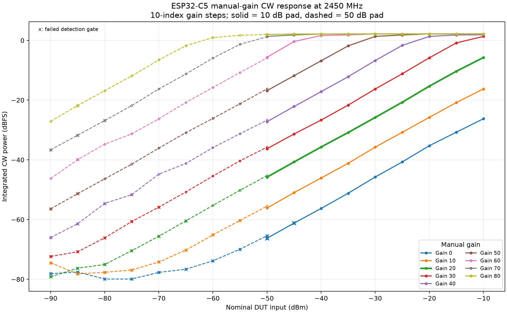
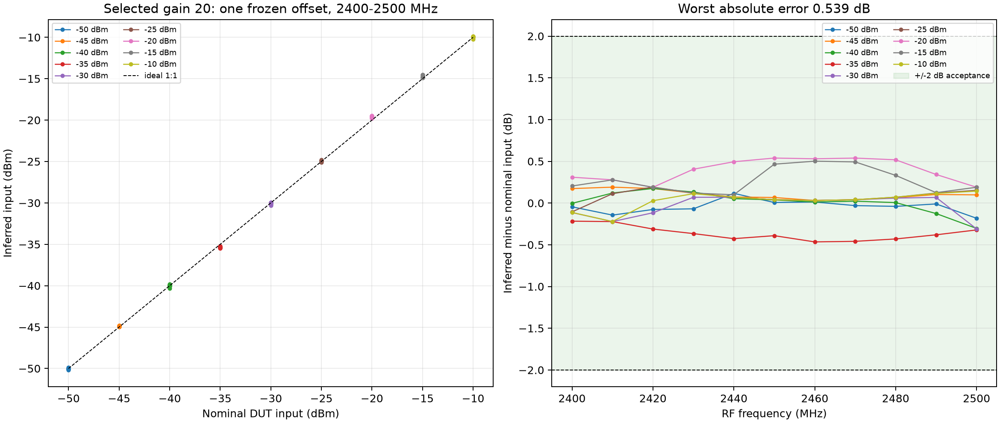
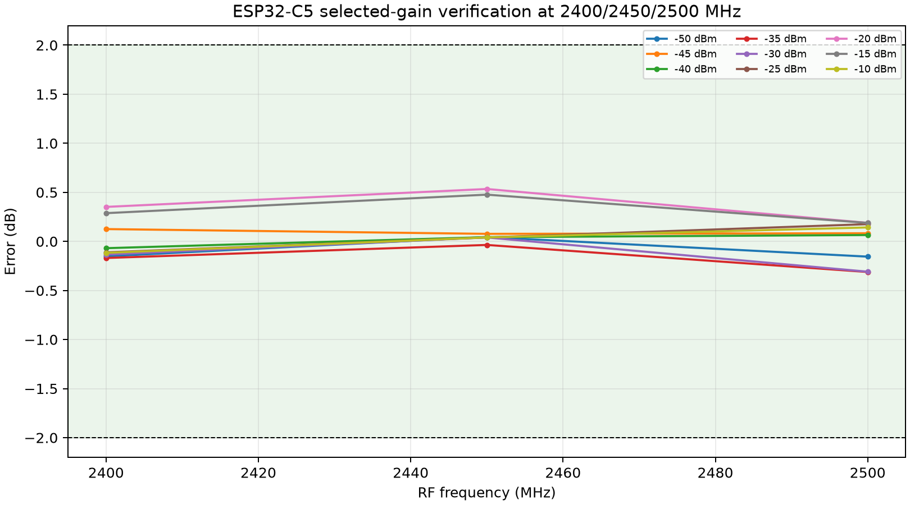
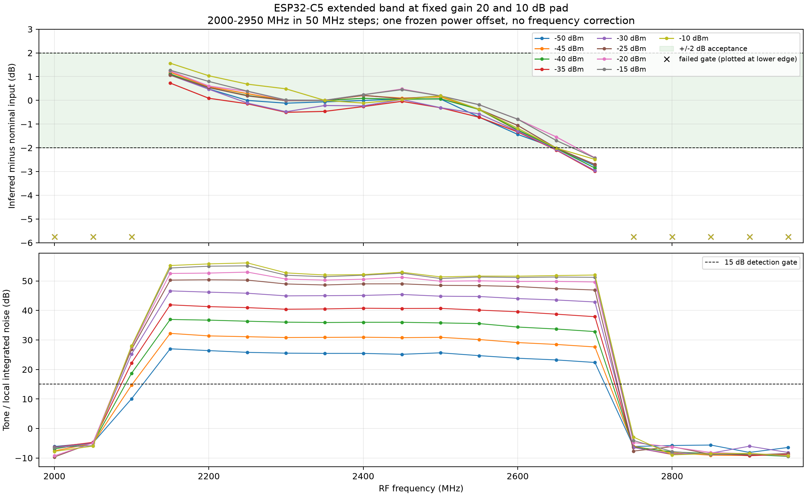
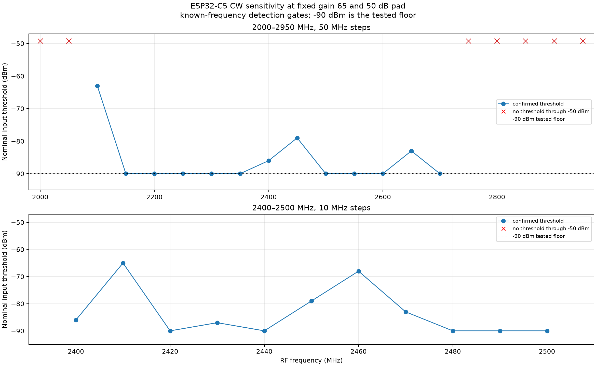
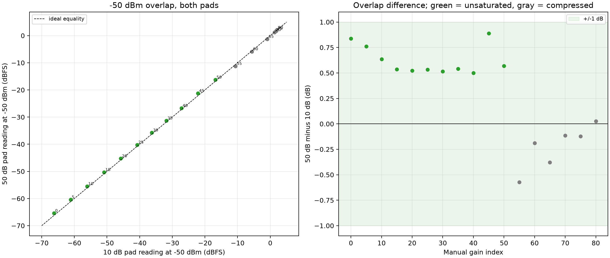
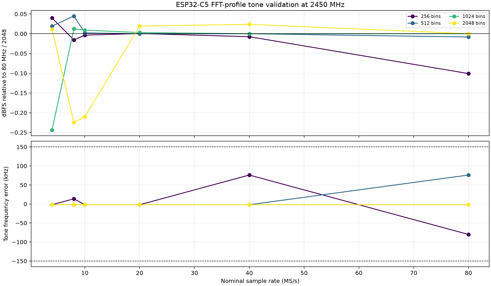

# ESP32-C5 CW power and sensitivity — phase 1 (10 dB) and phase 2 (50 dB)

## Status

Phase 1, the requested **2000–2950 MHz / 50 MHz-step extended band**, and
Phase 2 with the **50 dB pad** are complete. Phase 2 covers the 5-index gain
search, adaptive sensitivity, 10/50 dB overlap, raw ADC snapshots and all FFT
profiles.

All dBm values in this report are **nominal**: generator output minus the
nominal pad. No independent power meter, calibrated attenuator-vs-frequency
data or cable-loss measurement was available. The result is an empirical CW
power comparison, not an absolute traceable power calibration. It is also not
a noise figure, not a Wi-Fi packet/BER sensitivity, and not a general
modulated-signal or antenna-power specification. Phase-2 sensitivity is
**setup-limited known-frequency CW detectability**, not a noise figure, not a
Wi-Fi BER/packet-sensitivity result, and not an intrinsic receiver limit.

## Headline result

With manual gain **20**, one frozen power offset of **-4.188307 dB**, and no
frequency correction of that offset, the complete requested working grid
passed:

- RF **2400–2500 MHz in 10 MHz steps**
- nominal DUT input **-50 to -10 dBm in 5 dB steps**
- **99/99** capture points passed every gate
- **99/99** points were within +/-2 dB
- worst absolute error: **0.539 dB** at 2450 MHz / -20 dBm
- selected-gain verification at 2400, 2450 and 2500 MHz: **27/27** passed,
  worst error **0.534 dB**
- extended **2000–2950 MHz / 50 MHz-step** grid at the same gain 20: all gates
  valid **2150–2700 MHz**; all levels within +/-2 dB **2150–2600 MHz**
  (**90/90** captures, worst **1.566 dB**)
- Phase 2 selected **gain 65** for weak signals. Confirmed thresholds: **-90 dBm
  at 2150–2350, 2500–2600 and 2700 MHz** on the 50 MHz grid; **-79 dBm at
  2450 MHz**; **-65 dBm at 2410 MHz**; no threshold at 2000/2050/2750–2950 MHz.







Conversion used in this report:

```text
nominal DUT input estimate (dBm) = integrated CW reading (dBFS) - 4.188307
generator output estimate (dBm)   = nominal DUT input estimate + 10
```

The offset was anchored once at gain 20 / 2450 MHz / nominal -30 dBm and then
held fixed for every power and frequency. No slope, per-frequency correction,
per-power correction or gain switching was fitted to the validation data.

## Hardware, firmware and capabilities

| Item | Value |
| --- | --- |
| Board | `C5SDR 6 burst 16380`, ESP32-C5 profile |
| USB serial / board ID | `D0:CF:13:E5:A7:9C` |
| Firmware revision | `466a705d339f3cbbbd38a970b6bf9f1f0dfcfed2-dirty` |
| Build | 2026-10-21T19:34:07Z, profile `esp32c5` |
| Transport | USB, protocol 6 |
| `LIMITS?` | gain `[0,81,1]`; bandwidth `[11,48,1,0]` MHz; rates 80/40/20/10/8/4 MS/s; 8/10-bit I/Q |
| `GAIN?` note | the later manual-gain replies showed an upper field of 82 while `LIMITS?` advertised 81; no index above 80 was used |
| `CAPS` | `VERSION GPIO SPEC SPECN SPECCAPS SPECSTAT DCT UARTBAUD RXLIMITS GAIN HWAGC IQ8 SERIALLEASE TUNEEXT LPF LPF12 ALPF DUALSERIAL` |
| Reference generator | Rigol RSA3030N, serial `RSA3K253600108`, firmware `00.03.06` |
| Pad | supplied nominal **10 dB** attenuator (phase 1), changed to nominal **50 dB** (phase 2) |

The queries made at the start of every session were `INFO`, `VERSION?`,
`CAPS`, `LIMITS?`, `SPECINFO?`, `GAIN?`, `LPF?`, `DC?`, `TRANSPORT?` and
`RANGE?`. The highest advertised FFT profile was selected:
**80 MS/s, 2048 bins, 39.0625 kHz spacing, Hann ENBW 58.59375 kHz**. C5
spectra are snapshot profiles (`"continuous":false`); they are not S3-style
gapless ring capture.

No firmware was built or flashed. Hardware AGC was never enabled. Manual gain
was asserted and queried at the start of each session, before each gain change
and before each point. Reopening the USB port can return the board to
`GAIN HARDWARE`; this was observed during final checks, so every new session
reapplied and verified manual gain. The final state check reasserted and
verified **`GAIN MANUAL 20`**, `LPF AUTO`, `DC 1` and released the lease; RF
output was verified off.

## Acquisition and estimator

- Generator: zero-span, continuous CW, effective **100 s sweep time**, output
  enabled for measurements and disabled for source-off controls. The level was
  written, read back within **0.05 dB**, then allowed another **0.5 s** before
  capture. The generator error queue was drained and recorded at every point.
- RF is the generator frequency. The DUT LO was commanded to **RF - 2 MHz**
  every time, and the `SPEC` start reply was checked against that LO.
- Source-on captures used 1.5 s (gain search) or 2 s (selection verification,
  working band, extended band); source-off controls used 2 s. Each capture
  contained hundreds of frames and completed FFTs. The working band alone
  contains 35,669 frames and 71,171 FFTs; all measurement captures total
  **231,178 frames / 461,331 FFTs**, plus **40,933 control frames / 81,675
  control FFTs**.
- Power codes decode as `P = 10**(code/20)`. Completed-FFT counts weight the
  frame means. The expected tone is searched within +/-500 kHz; 11 bins centred
  on the peak are summed; the per-frame median noise from the 0.5–1.5 MHz
  annulus is subtracted from those bins. The result is normalized by the
  squared Hann full-scale amplitude and the Hann ENBW in bins, then reported
  as integrated **dBFS**.
- Five consecutive frame blocks per capture provide the stability statistic.
  They are within-capture blocks, not independent long-term repeats.
- Per-capture gates: every block SNR >= 15 dB; |frequency error| <= 150 kHz;
  on/off >= 10 dB versus the matching source-off capture; block peak-to-peak
  <= 0.5 dB; CRC32, framing, end-report accounting, frame drops, gain metadata,
  manual-gain queries, generator readbacks and source state all clean.

Source-off controls were acquired at the same gain, LO, profile and bin
configuration. High manual gains show substantial source-off background
peaks and spurs; for example, gain 41's source-off control had an apparent
-46.8 dBFS feature with large block variation. The on/off gate is therefore
essential and was applied to every point. It intentionally makes the weak
end **setup/background limited** rather than assuming that a local SNR peak is
a real received tone.

## Gain search and G_o selection

Gains **0–40 were measured at every index**. Following the later instruction,
gains **45, 50, 55, 60, 65, 70, 75 and 80** were measured in 5-index steps;
intermediate indices above 40 were not measured. All 49 tested gains were
measured at 2450 MHz over -50 to -10 dBm in 5 dB steps.

A gain was eligible only if its -30 dBm anchor passed the gates, one offset
made every point in a contiguous range within +/-2 dB, and the passing range
had at least 2 dB full-scale headroom. Gains **10 through 23** all achieved the
full 40 dB range (-50 to -10 dBm) with all gates passing and at least 2 dB
headroom.

| Gain | One-point offset (dB) | Full-range headroom at -10 dBm (dB) | Min in-range SNR at -50 dBm (dB) | Result |
| ---: | ---: | ---: | ---: | --- |
| 10 | +5.742 | 16.24 | 15.4 | full range |
| 15 | +0.727 | 10.74 | 20.7 | full range |
| 20 | -4.188 | 5.75 | 25.0 | **selected** |
| 21 | -5.181 | 4.76 | 26.0 | full range |
| 22 | -6.177 | 3.81 | 26.7 | full range |
| 23 | -7.191 | 2.79 | 27.2 | full range, boundary headroom |
| 24 | -8.208 | 1.81 | 27.9 | fails 2 dB headroom |

Gain 20 was selected as the engineering compromise inside the eligible set:
it kept 5.75 dB of measured full-scale headroom at -10 dBm and 25.0 dB SNR at
-50 dBm, rather than accepting the 2.79 dB headroom of the highest eligible
gain, 23. The selection was frozen in [`selection.json`](selection.json) before
the 2400/2450/2500 verification and before the full working-band sweep.

Lower gains failed the weak end by SNR/on-off: gain 9 at -50 dBm had only
14.5 dB SNR, and gains 0–8 failed earlier. Gains 24–29 still produced a full
linear range at 2450 but had less than the required 2 dB headroom at -10 dBm.
Gains 30 and above compressed before -10 dBm; gains 45–80 were only usable
over progressively narrower weak-input ranges. At very high gain the reported
integrated value saturated near +2.16 dBFS even as the generator was reduced,
so those readings are not valid power measurements.

## Working-band results

The validation grid was measured after freezing the gain, offset and frequency
model. All point and gate checks passed.

| Nominal input (dBm) | Capture points | Max abs error (dB) | Mean error (dB) | Max block p-p (dB) | Min SNR (dB) | Min on/off (dB) |
| ---: | ---: | ---: | ---: | ---: | ---: | ---: |
| -50 | 11 | 0.182 | -0.042 | 0.486 | 25.1 | 23.8 |
| -45 | 11 | 0.191 | +0.103 | 0.071 | 30.4 | 28.9 |
| -40 | 11 | 0.304 | +0.011 | 0.098 | 35.7 | 33.8 |
| -35 | 11 | 0.465 | -0.363 | 0.045 | 39.8 | 38.4 |
| -30 | 11 | 0.310 | -0.035 | 0.054 | 44.9 | 43.8 |
| -25 | 11 | 0.192 | +0.076 | 0.018 | 48.5 | 48.8 |
| -20 | 11 | **0.539** | +0.394 | 0.128 | 49.9 | 54.3 |
| -15 | 11 | 0.502 | +0.272 | 0.170 | 50.9 | 59.2 |
| -10 | 11 | 0.222 | +0.029 | 0.008 | 51.4 | 63.8 |

The worst point was **2450 MHz at -20 dBm**, over-reading by **0.539 dB**.
The error pattern is a small gain/band shape, not a fitted frequency
correction: no frequency-dependent power correction was applied. The full
capture-level data are in [`measurements.csv`](measurements.csv).

The one working-band point with a visibly marginal stability statistic was
2440 MHz / -50 dBm: its five blocks spanned **0.486 dB**, just inside the
0.5 dB gate. A fresh capture at the same setting had **0.06 dB** block p-p and
-45.84 dBFS versus -45.70 dBFS originally. This recheck is retained; the
original capture was not deleted or edited.

## Extended 2000–2950 MHz band (50 MHz steps)

The existing working-band measurement was extended to **2000–2950 MHz in
50 MHz steps** at the same fixed manual gain **20** and the same 10 dB pad.
All nine input levels (-50 to -10 dBm) were measured, giving 20 frequencies ×
9 levels = **180 captures**, plus 20 matching source-off controls. The same
frozen power offset (-4.188307 dB), estimator, gates and profile were used.
No new fit or frequency-dependent power correction was applied.



| Result | Range / value |
| --- | --- |
| All detection/gate criteria passed | **2150–2700 MHz** at every tested level |
| All levels within +/-2 dB | **2150–2600 MHz** |
| Captures in the 2150–2600 MHz joint grid | **90/90** passed every gate and +/-2 dB |
| Worst error in that joint grid | **1.566 dB** at 2150 MHz / -10 dBm |
| Minimum SNR in that joint grid | **23.8 dB** |
| Minimum on/off in that joint grid | **23.7 dB** |
| Maximum corrected frequency error in that joint grid | **19.9 kHz** |
| -30 dBm usable +/-2 dB range | **2150–2600 MHz** (max error 1.295 dB) |
| -15 dBm usable +/-2 dB range | **2150–2650 MHz** (max error 1.271 dB through 2600, 1.693 dB at 2650) |

Frequency-by-frequency behaviour:

- **2150–2600 MHz:** every tested level passed all gates and stayed within
  +/-2 dB. This is the robust joint accuracy range of the extended grid.
- **2650 MHz:** all gates passed, but the -50 to -35 and -30 dBm readings were
  just outside +/-2 dB (about -2.0 to -2.1 dB). The -20 and -15 dBm points
  remained inside (about -1.5 and -1.7 dB).
- **2700 MHz:** all gates passed, but the power error was -2.4 to -3.0 dB,
  outside the +/-2 dB criterion. A real tone is present, but the fixed
  single-offset conversion is no longer accurate there.
- **2100 MHz:** a tone is detected (10–28 dB SNR depending on level) but the
  corrected frequency error is about **-366 kHz**, so the 150 kHz frequency
  gate fails. This is retained as a failed point, not reported as a valid
  power reading. The raw response is not consistent with the 2200–2650 MHz
  LO/reference model.
- **2000, 2050 and 2750–2950 MHz:** no reliable tone was detected in this
  setup. The numbers produced by the noise search are not input-power
  measurements.

The 50 MHz grid is coarser than the 10 MHz working-band validation and does
not sample every frequency between the tabulated points. The extended result
establishes the measured ranges above, not an interpolated band edge or a
continuous-band specification.

## Phase 2 — 50 dB pad

### Gain selection G_lp

The 50 dB pad puts the generator's -40..0 dBm range at nominal DUT inputs
**-90..-50 dBm**. The gain search was run at 2450 MHz in **5-index steps**
(0, 5, …, 80). Fine tuning was then restricted, as instructed, to the five
indices **63–67** around the coarse candidate. Selection used the weakest
input that passed the detection gates, with five-block standard deviation as
the tie-breaker.

**Selected gain: 65.** At -90 dBm it passed with:

| Metric | Value |
| --- | ---: |
| Nominal input | -90 dBm |
| Integrated output | -40.79 dBFS |
| Block SNR | 20.76 dB |
| On/off excess | 20.59 dB |
| Five-block standard deviation | 0.0164 dB |
| Five-block peak-to-peak | 0.0330 dB |

Gains 60, 65 and 80 also passed -90 dBm in the coarse scan; their block
standard deviations at -90 dBm were 0.081, 0.039 and 0.194 dB. Fine gains 63
and 64 passed at -90 dBm with 0.0265 and 0.0433 dB standard deviation. Gain 66
failed the on/off gate because of source-off background, and gain 67 passed
only at -85 dBm (on/off 7.6 dB at -90). The selection was frozen in `selection.json` (`phase2`) before the frequency scans.

### Sensitivity at G_lp = 65

The adaptive scan used a 5 dB coarse ascent, 1 dB refinement and two
confirmations at the candidate level. A threshold is reported only when three
captures at the same nominal input pass all detection gates. Failed captures
are recorded in [`measurements.csv`](measurements.csv).

Detection gates were: every five-block SNR >= 15 dB; |frequency error|
<= 150 kHz; on/off >= 10 dB against the matching source-off capture; matching
low-seven-bit gain metadata; clean CRC/framing/report accounting; and no
generator errors. The 0.5 dB block peak-to-peak gate was **not** used as a
detection gate; it is a power-accuracy gate.



**2200–2600 MHz, 50 MHz steps**

| RF (MHz) | Confirmed nominal input (dBm) | Weaker failed level (dBm) |
| ---: | ---: | ---: |
| 2200 | -90 (tested floor) | — |
| 2250 | -90 (tested floor) | — |
| 2300 | -90 (tested floor) | — |
| 2350 | -90 (tested floor) | — |
| 2400 | -86 | -87 |
| 2450 | -79 | -80 |
| 2500 | -90 (tested floor) | — |
| 2550 | -90 (tested floor) | — |
| 2600 | -90 (tested floor) | — |

**2400–2500 MHz, 10 MHz steps**

| RF (MHz) | Confirmed nominal input (dBm) | Weaker failed level (dBm) |
| ---: | ---: | ---: |
| 2400 | -86 | -87 |
| 2410 | -65 | -66 |
| 2420 | -90 (tested floor) | — |
| 2430 | -87 | -88 |
| 2440 | -90 (tested floor) | — |
| 2450 | -79 | -80 |
| 2460 | -68 | -69 |
| 2470 | -83 | -84 |
| 2480 | -90 (tested floor) | — |
| 2490 | -90 (tested floor) | — |
| 2500 | -90 (tested floor) | — |

**2000–2950 MHz extension, 50 MHz steps.** The requested wide scan plus the
fine 10 MHz band gives 28 unique frequencies. Results:

- no threshold through -50 dBm at **2000, 2050, 2750, 2800, 2850, 2900 or
  2950 MHz**;
- **2100 MHz:** threshold -63 dBm, but this is a frequency-gate outlier (see
  below);
- **2150–2350 MHz:** -90 dBm tested floor;
- **2400 MHz:** -86 dBm; **2450 MHz:** -79 dBm; **2500–2600 MHz:** -90 dBm floor;
- **2650 MHz:** -83 dBm; **2700 MHz:** -90 dBm floor.

The median confirmed threshold on the requested 2200–2600 MHz grid is
**-90 dBm**; the worst is **-79 dBm at 2450 MHz**. On the 2400–2500 MHz grid
the median is **-87 dBm** and the worst is **-65 dBm at 2410 MHz**. These are
**setup-limited** results. A -90 dBm entry means the threshold is at or below
the weakest tested input, not that an intrinsic -90 dBm limit was measured.

### Outliers and source-off background

Several frequencies are limited by source-off background rather than tone SNR:

- **2410 MHz:** threshold -65 dBm; the source-off control had a very strong
  in-band feature and 30–50 dB block variation.
- **2450 MHz:** threshold -79 dBm; the source-off background was only about
  21 dB below the tone at the -79 dBm candidate, so the 10 dB on/off gate sets
  the threshold well above the SNR limit.
- **2460 and 2470 MHz:** thresholds -68 and -83 dBm, again limited by the
  source-off background.
- **2100 MHz:** a tone was detected, but the corrected frequency error at weak
  levels was about -209 kHz, outside the 150 kHz gate. The threshold of
  -63 dBm was reached only where the response moved to about -131 kHz. This
  frequency is retained as a failed-gate outlier, not treated as a normal
  sensitivity point.

Raw `CAP20 16380 0` snapshots at gain 65 (three source-off and three source-on
repetitions per frequency) are summarised in [`raw_adc.csv`](raw_adc.csv). **No exact or near ADC rail hits occurred** in
these snapshots. The high source-off RMS at 2100 MHz (-27.1 dBFS), 2410 MHz
(-34.6 dBFS), 2450 MHz (-27.4 dBFS) and 2460 MHz (-31.2 dBFS) is in-band
background/spur energy, not raw ADC clipping. This is why the on/off gate is
part of the sensitivity definition.

### Usable range at G_o (10 dB pad)

Step 6 of the phase-2 plan asks for the phase-1 G_o = 20 response at the two
pre-selected stable levels **-30 and -15 dBm**. Those levels cannot be applied
through the 50 dB pad (the generator would need +20/+35 dBm, above its 0 dBm
limit), so this part reuses the phase-1 10 dB-pad data. No new fit or
correction was applied.

| Level | Grid | Within +/-2 dB | Worst error |
| ---: | --- | --- | ---: |
| -30 dBm | 2000–2950 MHz, 50 MHz | **2150–2600 MHz** | 1.295 dB |
| -30 dBm | 2400–2500 MHz, 10 MHz | **all 11 frequencies** | 0.310 dB |
| -15 dBm | 2000–2950 MHz, 50 MHz | **2150–2650 MHz** | 1.693 dB |
| -15 dBm | 2400–2500 MHz, 10 MHz | **all 11 frequencies** | 0.502 dB |

The existing error-vs-frequency figures
[`plots/working_band.png`](plots/working_band.png) and
[`plots/extended_band_50mhz.png`](plots/extended_band_50mhz.png) are the
corresponding phase-1 plots; they were not replaced by phase-2 data. The
machine-readable ranges are in [`usable_range_10db.csv`](usable_range_10db.csv).

### 10 dB / 50 dB overlap at -50 dBm

The overlap compares the phase-1 10 dB-pad reading with the phase-2 50 dB-pad
reading at the same nominal **-50 dBm** DUT input. No alignment or correction
was fitted.

| Result | Value |
| --- | ---: |
| Valid unsaturated gains | 10, 15, 20, 25, 30, 35, 40, 45, 50 |
| Mean 50-minus-10 dB difference | +0.582 dB |
| Worst absolute difference | **0.888 dB** (gain 45) |
| Gains above 50 | compressed at -50 dBm; excluded from the statistic |



See [`pad_overlap.csv`](pad_overlap.csv). The small positive offset is within
the observed gain/level repeatability and is not used to change the phase-1
power offset.

### FFT coverage

All **24 advertised profiles** were measured at 2450 MHz with a nominal -50 dBm
input at gain 60. For every profile the corrected tone peak was at the expected
signed baseband position, not at an alias. Results:

| Check | Result |
| --- | --- |
| Profiles | 24: 80/40/20/10/8/4 MS/s × 256/512/1024/2048 bins |
| Integrated power spread vs 80 MHz / 2048 | **0.244 dB** maximum |
| Maximum corrected frequency error | **80.2 kHz** (coarse 256-bin profiles) |
| Minimum mirror/image rejection | **36.3 dB** |
| Peak-bin/alias check | all 24 at the expected bin |
| Frames / FFTs | **15,964 / 33,966** |

The profile table, spacing and Hann ENBW (1.5 × spacing) are in
[`fft_profiles.csv`](fft_profiles.csv) and in `summary.json` (`phase2`).



### Phase-2 integrity

- **391** phase-2 captures/controls were replayed from raw codes and headers;
  all metrics reproduced with **0.0** difference and all end reports, frame
  counts, FFT counts, gain metadata and frame accounting matched.
- **36** raw ADC snapshots were re-decoded; payload CRCs and signed I/Q arrays
  matched the saved data.
- The phase-2 gain selection timestamp precedes the sensitivity scan.
- Final state passed: RF off, generator error queue empty, manual gain 65
  reasserted and verified, lease released.
- Phase-2 capture counts: 153 coarse gain-search, 15 fine gain-search, 177
  sensitivity and 24 FFT-profile captures; 125,419 spectrum frames and
  252,337 completed FFTs including the FFT-profile runs.

### Phase-2 limits

- All dBm values are **nominal generator level minus the nominal 50 dB pad**.
  No independent power meter or calibrated attenuator data was available.
- Sensitivity is known-frequency CW detectability in this estimator and setup,
  not Wi-Fi packet/BER sensitivity, not a noise figure and not a thermal-noise
  limit.
- Source-off background and spurs set several thresholds. They are part of the
  measured setup, not separated from receiver-generated or environmental
  contributions.
- -90 dBm is the weakest tested input. A threshold shown as -90 dBm is at or
  below that floor; it is not proof of an intrinsic -90 dBm limit.
- The 50 MHz extended sensitivity grid does not sample every frequency; the
  10 MHz 2400–2500 MHz grid is the finer measurement. No interpolation between
  measured points is implied.
- Gains above 50 are compressed at -50 dBm and are excluded from the pad-overlap
  statistic. The overlap difference is not used to alter the phase-1 offset.

## Frequency/LO correction (frequency only)

The C5 LO/reference, observed against the generator readback, shows a
systematic **positive frequency scale error** of about **+146 ppm**. No
independent frequency standard was available, so this is a combined
DUT-LO-versus-generator observation. With LO commanded to RF - 2 MHz,
the tone appears near **-1.64 MHz** in the hardware I/Q convention rather than
at -2 MHz. At 2450 MHz the raw peak was about **-359 kHz** from the commanded
RF, which would fail the 150 kHz frequency gate if interpreted directly.

A raw `CAP20` burst at each calibration frequency was used to estimate the
signed baseband tone with a zero-padded Hann periodogram. A linear model
`LO offset = intercept + slope * RF` was fitted:

| Calibration run | Slope (ppm) | Offset at 2450 MHz (Hz) | Max model residual (Hz) |
| --- | ---: | ---: | ---: |
| model used by the data (before validation) | 146.119 | 357,312 | 23.4 |
| clean repeat at phase start | 146.936 | 359,540 | 53.7 |
| clean repeat at phase end | 146.691 | 359,339 | 20.7 |

The clean start/end repeats differ by only **0.20 kHz** at 2450 MHz. The model
used during the phase 1 captures differs from the clean end repeat by about
**2.03 kHz**, attributed to a small LO/reference drift between the initial
calibration and the later repeats. This is still far inside the 150 kHz gate.

This correction is applied **only to the frequency axis**, and it is a
frequency-only model of that combined observation. The power offset
`-4.188307 dB` is anchored once and is never frequency corrected. Raw and
corrected frequency errors are both retained in the raw JSON: for the working
band the corrected maximum is **9.37 kHz**, while the uncorrected maximum is
**359.375 kHz**. The frequency correction is specific to this board, firmware,
LO mode and setup; it is not a power correction and does not imply that the
power response was flattened.

## Integrity and replay

[`validation.json`](validation.json) contains the machine-readable checks.

- **861** saved on-chip FFT captures/controls were replayed from their raw
  codes and headers. Tone power, SNR, corrected and raw frequency, block
  standard deviation, block peak-to-peak and on/off excess reproduced with
  **0.0** difference from the saved values.
- Each replay also checked the end report, frame/FFT accounting, codes shape,
  low-seven-bit gain metadata and zero drops. All passed.
- **60** raw CAP20 calibration bursts were replayed; the IF estimates
  reproduced with **0 Hz** difference.
- The selection timestamp precedes the verification and working-band
  timestamps.
- The phase-1 final state check passed: RF output off, generator error queue
  empty, board re-queried as `GAIN MANUAL 20`, `LPF AUTO`, `DC 1`, lease
  released. The `final_state` record in `validation.json` is the phase-2 state with
  `GAIN MANUAL 65`; the phase-1 entry embeds the earlier state.
- Live acquisition checked CRC32 and framing before accepting every frame;
  those checks are recorded in the session logs and measurement metadata.

The metrics computed at acquisition time from the power codes, frame headers
and end reports are recorded in `measurements.csv`.

## Instrument/tool issue retained in the record

The first LO-calibration run wrote its model correctly but its per-point list
was overwritten by a tool bug after the model was saved. The working-band
captures used the model saved in that run; the clean repeat confirms it and is
the calibration record in `lo_calibration.csv` and in the `lo_calibration`
block of `selection.json`. This affects only calibration metadata, not any power
capture.

A second observed instrument quirk is that the RSA3030N reports
`TIME:AUTO? = 1` in zero span even when a numeric **100 s** sweep time is
effective. The acquisition checks the numeric sweep-time readback and the
actual zero-span/continuous/output state at every source-on point. No library
was modified.

## Data files

| File | Content |
|---|---|
| `measurements.csv` | per-capture metrics, both pads, source-on and source-off |
| `sensitivity.csv` | confirmed CW threshold per RF with the weaker failed level |
| `pad_overlap.csv` | 10 dB vs 50 dB reading comparison at -50 dBm |
| `fft_profiles.csv` | per-profile tone accuracy, image rejection, frame and FFT counts |
| `raw_adc.csv` | source-off raw ADC statistics: rail hits, AC RMS and peak count |
| `lo_calibration.csv` | LO offset versus RF |
| `usable_range_10db.csv` | ±2 dB frequency intervals |
| `selection.json` | frozen gain, offset and gate decisions plus the LO calibration model |
| `summary.json` | band statistics, integrity and limits |
| `validation.json` | replay outcomes, checks and final instrument state |
| `plots/` | figures referenced above |

Acquisition and analysis scripts are in the repository's `tools/` directory.

## Limits of the conclusion

- The +/-2 dB criterion is an empirical comparison to **generator setting minus
  the nominal 10 dB pad**. Generator accuracy, pad loss versus frequency,
  connectors, mismatch and the DUT's own gain shape are all included in the
  observed response and were not separated.
- The power offset is device-, firmware-, bandwidth-, LO-offset- and
  connection-specific, and is valid only for this manual gain and this
  estimator. Gain indices are not dB gains.
- The result is integrated CW dBFS. It is not a peak-power, modulated-signal,
  antenna-power or absolute traceable power calibration. It is not a noise
  figure and not a Wi-Fi BER/packet sensitivity.
- The frequency model is a frequency-only correction for the measured
  LO/reference scale error. It is not a power correction. No frequency
  interpolation or continuous-band guarantee is implied.
- The extended range is measured only on the 50 MHz grid. The 10 MHz grid
  (2400–2500 MHz) remains the complete working-band validation. In particular,
  2650–2700 MHz passed the detection gates but not the +/-2 dB power accuracy
  at all levels, and 2100 MHz failed the frequency gate despite a detected
  tone.
- Phase-2 sensitivity is setup-limited CW detectability, not a noise figure,
  not Wi-Fi BER/packet sensitivity and not a thermal-noise limit. Thresholds
  shown at -90 dBm are at the weakest tested input.
- Phase 2 uses the nominal 50 dB pad. The phase-1 +/-2 dB power offset is not
  applied to the phase-2 sensitivity thresholds; phase-2 results are detection
  thresholds, not calibrated absolute power readings.
