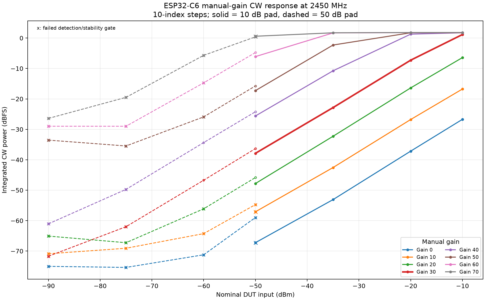
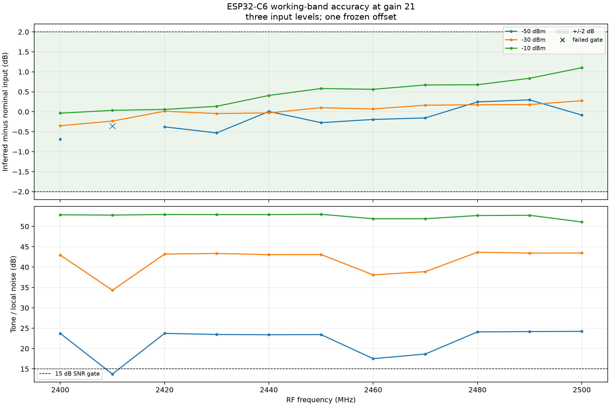
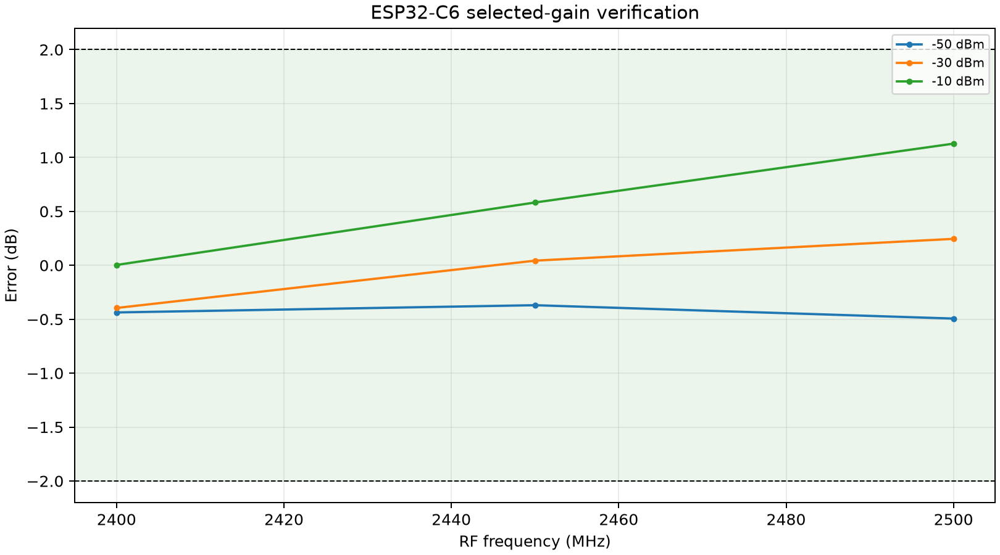
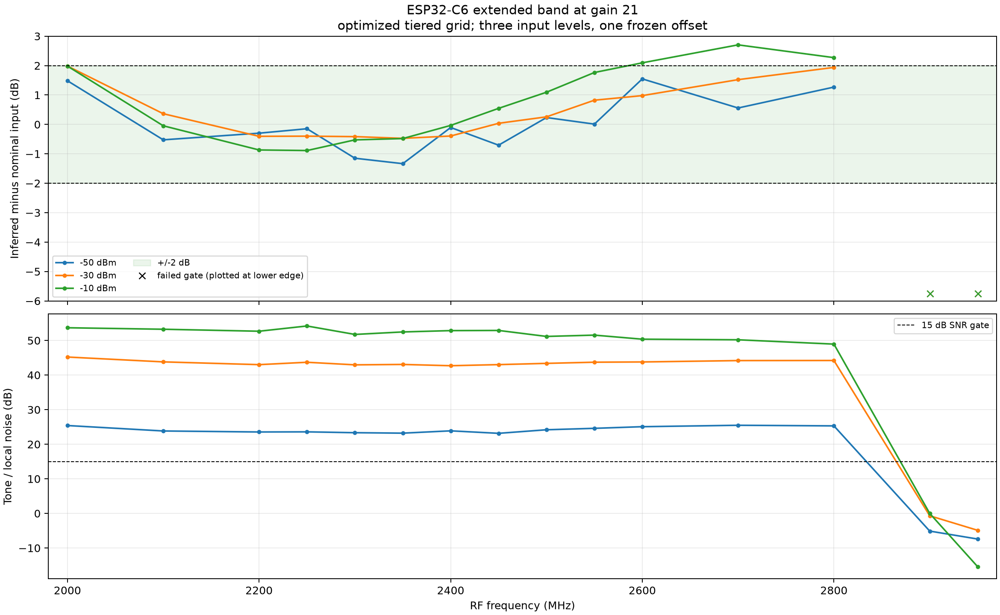
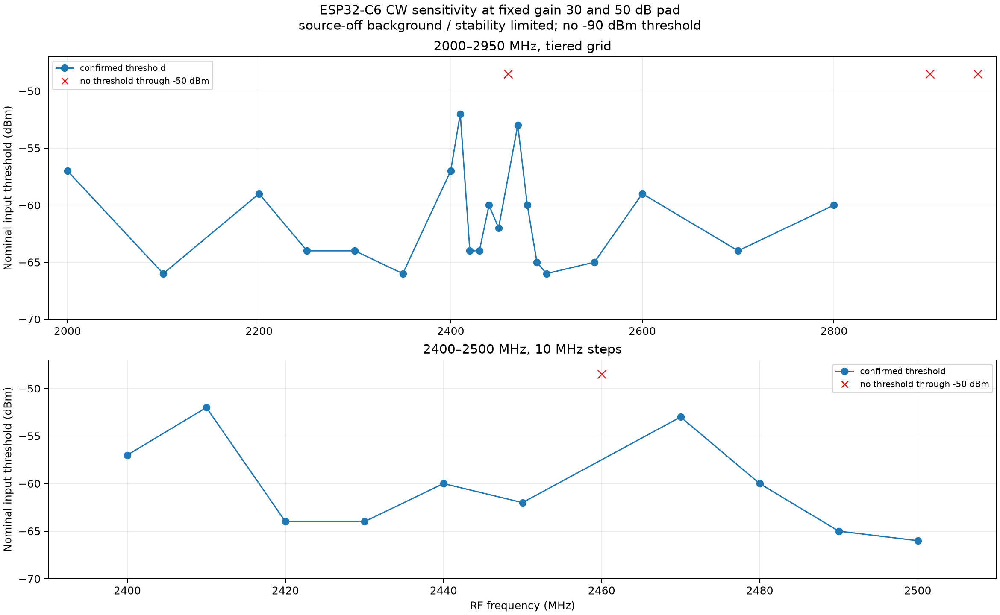
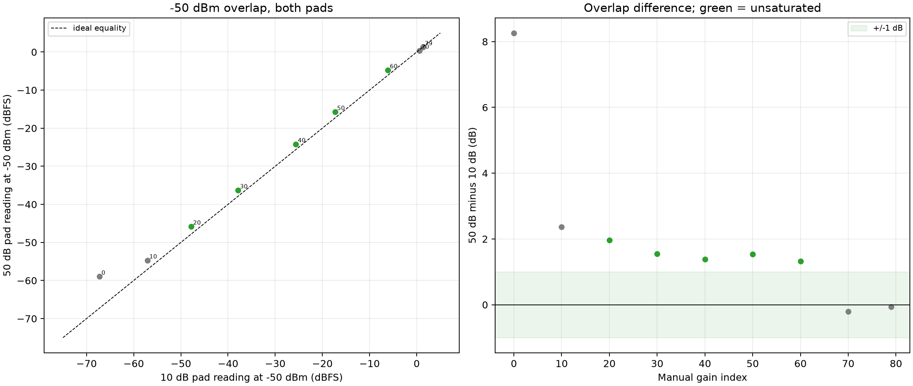
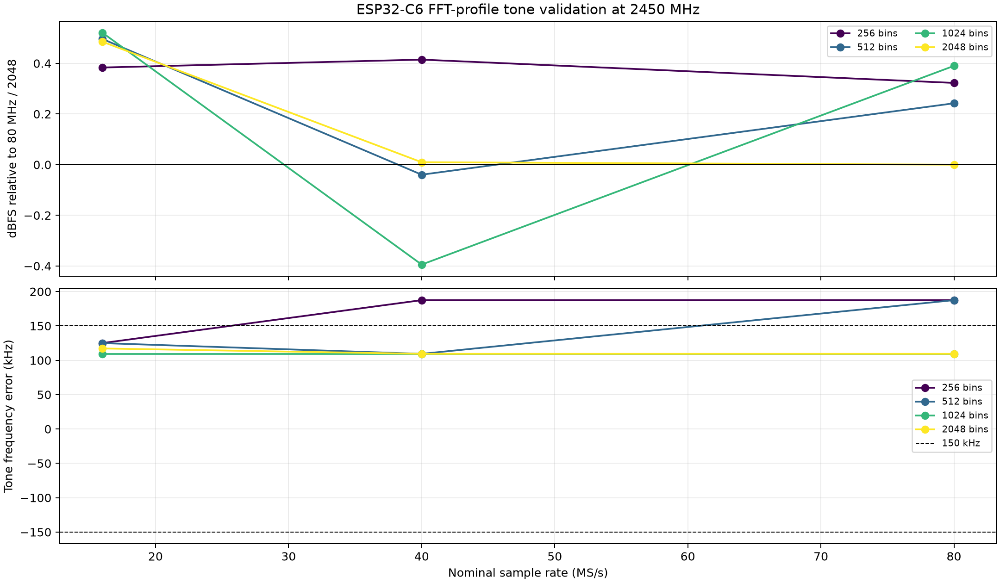

# ESP32-C6 CW power and sensitivity — phase 1 (10 dB) and phase 2 (50 dB)

## Status

Phase 1 and Phase 2 are complete for the connected **ESP32-C6**. Phase 2 used
the **50 dB pad**, the 10-index coarse gain grid, stability-aware G_lp
selection, sensitivity, overlap, raw ADC and FFT-profile validation.

All dBm values are **nominal**: generator output minus the nominal pad. No
independent power meter or calibrated attenuator data was available. This is
integrated CW dBFS, not a traceable absolute power calibration, noise figure or
Wi-Fi BER result.

## Headline result

With manual gain **21** and one frozen offset of **-3.699680 dB**:

- working band **2400–2500 MHz / 10 MHz steps** at **-50, -30 and -10 dBm**:
  **32/33** captures passed every gate; all valid points were within +/-2 dB
- worst valid working-band error: **1.103 dB**
- selected-gain verification at 2400/2450/2500 MHz: **9/9 passed**, worst
  **1.128 dB**
- extended optimized grid **2000–2950 MHz** at the same three levels:
  - **-50 dBm:** all measured points **2000–2800 MHz** within +/-2 dB
  - **-30 dBm:** all measured points **2000–2800 MHz** within +/-2 dB
  - **-10 dBm:** all measured points **2000–2550 MHz** within +/-2 dB
  - joint all-three-level range: **2000–2550 MHz**
  - no reliable tone at **2900/2950 MHz**
- phase-2 selected **G_lp = 30**; best sensitivity threshold **-66 dBm**,
  worst **-52 dBm**; no -90 dBm threshold was achieved.

One working-band capture failed the gates and is retained:
**2410 MHz / -50 dBm** (SNR 13.74 dB, below the 15 dB gate). All other
working-band points passed.









## Board and firmware

| Item | Value |
| --- | --- |
| Board | `C6SDR 6 burst 16380`, ESP32-C6 |
| USB serial | `58:E6:C5:1D:DE:F8` |
| Firmware revision | `9b61e7465bee6da15209c5c09308043d08c46a1d` |
| Build | 2026-10-26T21:26:32Z, profile `esp32c6` |
| Transport | USB, protocol 6 |
| `LIMITS?` | gain `[0,79,1]`; bandwidth `[12,54,1,0]` MHz; rates 80/40/16 MS/s; 8/10-bit I/Q |
| Highest FFT profile | **80 MS/s, 2048 bins**, snapshot (`continuous:false`) |
| LPF controls | `LPF?` returns `ERR command`; `ALPF?` = `ALPF -1 28 28`; `ALPF AUTO` used for cleanup |
| Reference generator | Rigol RSA3030N `RSA3K253600108`, firmware `00.03.06` |

The pad check at gain 20 / 2450 MHz / generator -20 dBm read **-26.96 dBFS**,
confirming the 10 dB pad. Frequency error was a constant **+109.375 kHz** at
2450 MHz, inside the 150 kHz gate. At 2800 MHz it was **148.4 kHz**, still
inside; no frequency correction was applied.

## Optimizations used

| Change | Applied | Effect |
| --- | --- | --- |
| Coarse gain grid | **0, 10, 20, …, 70, 79** | 9 coarse gains instead of 17 |
| Coarse powers | **-50, -35, -20, -10 dBm** | 4 instead of 9 for the coarse scan |
| Candidate confirmation | full 9 levels for gains 18–22, already collected | selection accuracy retained |
| Further fine gain search | **none** after the instruction | no additional gain captures |
| Survey captures | **1 s** | faster coarse gain search |
| Final captures | **2 s** | power-band and verification gates |
| Small-step settling | **0.25 s** | after <=5 dB level changes |
| Large-step settling | **0.5 s** | frequency changes and larger level changes |
| Extended frequency grid | tiered: 50 MHz in 2200–2600, 100 MHz outside | 15 extended points instead of 20 |
| Band controls | 23 frequencies once | reused across all three powers |

This reduced phase 1 to **225 on-chip captures/controls** (101 gain-search,
87 band/verification, 37 controls), 41,352 measurement frames and 9,581 control
frames.

## G_o selection

The coarse scan used four powers for gains 0, 10, …, 70, 79. The 18–22
candidate window was already fixed; the full 9-level candidate scan used only
those five gains and did not add any new gain indices. No further fine gain
search was performed.

| Gain | Max abs error (9 levels) | Headroom | Min SNR | Max block std |
| ---: | ---: | ---: | ---: | ---: |
| 18 | 0.502 dB | 8.25 dB | 16.1 dB | 0.179 dB |
| 19 | 0.636 dB | 7.24 dB | 16.1 dB | 0.137 dB |
| 20 | 0.650 dB | 6.25 dB | 16.2 dB | 0.176 dB |
| **21** | **0.495 dB** | **5.81 dB** | **23.1 dB** | **0.054 dB** |
| 22 | 0.505 dB | 4.82 dB | 23.3 dB | 0.067 dB |

Gain 21 was selected for the best worst-case error, lowest block std, good
headroom and substantially better weak-input SNR than gains 18–20. The decision
is frozen in [`selection.json`](selection.json). No further fine gain search
was performed.

## Working band (three input levels)

Only **-50, -30 and -10 dBm** were used.

| Input | Captures | Gate failures | Max abs error among valid points |
| ---: | ---: | --- | ---: |
| -50 dBm | 11 | 2410 MHz (SNR 13.74 dB) | 0.69 dB |
| -30 dBm | 11 | none | 0.35 dB |
| -10 dBm | 11 | none | 1.10 dB |

All 32 valid points are within +/-2 dB. The failed 2410 MHz point is retained
in [`measurements.csv`](measurements.csv) and marked in the plot.

## Extended band (optimized tiered grid)

The extended grid was:

```text
2000, 2100, 2200, 2250, 2300, 2350, 2400, 2450, 2500,
2550, 2600, 2700, 2800, 2900, 2950 MHz
```

| Input | Within +/-2 dB at all measured points | Notes |
| ---: | --- | --- |
| -50 dBm | **2000–2800 MHz** | 2900/2950 gate failures |
| -30 dBm | **2000–2800 MHz** | 2900/2950 gate failures |
| -10 dBm | **2000–2550 MHz** | 2600/2700/2800 outside +/-2 dB |
| joint all three | **2000, 2100, and 2200–2550 MHz** | tiered grid |

No reliable tone was found at **2900/2950 MHz**. The worst valid extended-band
error was **2.70 dB at 2700 MHz / -10 dBm** (outside the joint range). The
extended grid is not a continuous 50 MHz scan outside 2200–2600 MHz; the
measured frequencies are listed in `summary.json` and `measurements.csv`.

## Phase 2 — 50 dB pad

### Pad verification and G_lp selection

The 50 dB pad was verified at gain 20 / 2450 MHz: generator -20 dBm (nominal
-70 dBm input) read **-64.08 dBFS**, consistent with 50 dB.

The gain search used the same **10-index coarse grid** (0, 10, …, 70, 79) and
four powers (-90, -75, -60, -50 dBm). **No fine gain search was performed.**
G_lp selection required the detection gates **plus the 0.5 dB power-stability
gate**, to avoid selecting a high-gain background artifact.

**Selected G_lp = 30.** At -60 dBm:

| Metric | Value |
| --- | ---: |
| Block SNR | 20.93 dB |
| On/off excess | 16.21 dB |
| Five-block standard deviation | 0.0390 dB |
| Five-block peak-to-peak | 0.103 dB |

Gain 50 at -90 dBm passed detection-only gates, but had **31.45 dB block p-p**
and only 10.6 dB on/off. It is retained as a background artifact and is not used
as a usable sensitivity point. Gains 30 and 40 both reached -60 dBm with the
stability gate; gain 30 had the lower block std.

### Sensitivity at G_lp = 30

The adaptive scan used the 5 dB coarse / 1 dB refine / two-confirmation
procedure. **No -90 dBm threshold was achieved.** The best confirmed threshold
was **-66 dBm**.



**2200–2600 MHz, 50 MHz steps — 9/9 confirmed**

| RF | Threshold | RF | Threshold |
| ---: | ---: | ---: | ---: |
| 2200 | -59 | 2400 | -57 |
| 2250 | -64 | 2450 | -62 |
| 2300 | -64 | 2500 | -66 |
| 2350 | -66 | 2550 | -65 |
|  |  | 2600 | -59 |

**2400–2500 MHz, 10 MHz steps — 10/11 confirmed**

| RF | Threshold | RF | Threshold |
| ---: | ---: | ---: | ---: |
| 2400 | -57 | 2460 | **no threshold** |
| 2410 | -52 | 2470 | -53 |
| 2420 | -64 | 2480 | -60 |
| 2430 | -64 | 2490 | -65 |
| 2440 | -60 | 2500 | -66 |
| 2450 | -62 |  |  |

**2000–2950 MHz tiered grid:** 20/23 frequencies confirmed. No threshold at
**2460, 2900 or 2950 MHz**. The confirmed thresholds were: 2000 -57, 2100 -66,
2200 -59, 2250 -64, 2300 -64, 2350 -66, 2400 -57, 2410 -52, 2420 -64,
2430 -64, 2440 -60, 2450 -62, 2470 -53, 2480 -60, 2490 -65, 2500 -66,
2550 -65, 2600 -59, 2700 -64, 2800 -60 dBm.

These are **setup-limited** results. The on/off gate, not tone SNR, sets most
thresholds.

### Outliers, source-off background and raw ADC

Raw `CAP20 16380 0` snapshots at gain 30 are summarised in [`raw_adc.csv`](raw_adc.csv).

- **No exact or near ADC rail hits** occurred in these gain-30 snapshots.
- Source-off background was strong at 2400/2410/2460/2470 MHz (about -40 dBFS),
  limiting the on/off gate.
- **2900 MHz:** source-off RMS about -17.3 dBFS and no source-on tone; no
  threshold.
- **2950 MHz:** source-on raw RMS about -37.3 dBFS but no reliable spectral
  tone at the expected frequency; no threshold.
- **2460 MHz:** no threshold despite a visible source-on response; the on/off
  and confirmation gates did not produce three passes.

### Usable range at G_o (10 dB pad, phase 1)

The phase-1 G_o = 21 data are reused; no new 10 dB measurements were made.

| Level | Within +/-2 dB on the tiered extended grid |
| ---: | --- |
| -50 dBm | **2000–2800 MHz** |
| -30 dBm | **2000–2800 MHz** |
| -10 dBm | **2000–2550 MHz** |
| joint all three | **2000–2550 MHz** |

The corresponding phase-1 plots are
[`plots/working_band.png`](plots/working_band.png) and
[`plots/extended_band.png`](plots/extended_band.png).

### 10 dB / 50 dB overlap at -50 dBm

| Result | Value |
| --- | ---: |
| Valid unsaturated gains | 20, 30, 40, 50, 60 |
| Mean 50-minus-10 dB difference | **+1.554 dB** |
| Worst absolute difference | **1.968 dB** |



No correction was fitted. The positive offset is consistent with a nominal
pad/setup difference of roughly 1–2 dB.

### FFT coverage

All **12 advertised C6 profiles** were measured at 2450 MHz with nominal
-50 dBm input at gain 60.

| Check | Result |
| --- | --- |
| Profiles | 12: 80/40/16 MS/s × 256/512/1024/2048 bins |
| Integrated power spread vs 80 MHz / 2048 | **0.521 dB** maximum |
| Maximum frequency error | **187.5 kHz** (40/256: 1.2 bins; 80/256: 0.6 bins) |
| Minimum mirror/image rejection | **15.4 dB** (16/256) |
| Peak position | all at the expected signed baseband position |
| Frames / FFTs | **4,786 / 4,786** |



The 109 kHz board frequency offset explains the larger error in the fine-bin
profiles; the peak is not at an alias. C6 snapshot spectra produce one FFT per
frame.

### Phase-2 integrity

- **368** captures/controls/FFT profiles replayed with **0.0** metric
  difference.
- **48** raw ADC snapshots re-decoded; payload CRCs and I/Q arrays matched.
- All reports, frame/FFT counts, code shapes, gain metadata and frame accounting
  matched.
- The phase-2 selection precedes the sensitivity scan.
- Final state passed: RF off, generator errors empty, manual gain 30,
  `ALPF AUTO`, `DC 1`, lease released.
- Phase-2 spectrum totals: **82,377 frames / 82,377 FFTs**.

### Phase-2 limits

- Nominal 50 dB pad only; overlap against the 10 dB data differs by 1–2 dB.
- G_lp was selected with a stability gate; the gain-50/-90 point is a documented
  artifact, not a sensitivity result.
- Sensitivity is known-frequency CW detectability, not Wi-Fi BER, noise figure
  or a thermal-noise limit.
- No -90 dBm threshold was achieved; the best observed was -66 dBm.
- The tiered extended grid is not a continuous 50 MHz scan outside 2200–2600 MHz.

## Integrity

- **225** captures/controls replayed from raw codes and headers with **0.0**
  metric difference.
- All reports, frame/FFT counts, code shapes, low-seven-bit gain metadata and
  frame accounting matched.
- Measurement sessions: 41,352 frames / 41,352 FFTs. Controls: 9,581 frames /
  9,581 FFTs. C6 snapshot spectra produce one FFT per frame here.
- The selection timestamp precedes the final band acquisitions.
- Phase-1 final state passed with gain 21. The `final_state` record in
  `validation.json` is the phase-2 gain-30 entry; the phase-1 entry embeds the
  gain-21 state.

## Data files

| File | Content |
|---|---|
| `measurements.csv` | per-capture metrics, both pads, source-on and source-off |
| `sensitivity.csv` | confirmed CW threshold per RF with the weaker failed level |
| `pad_overlap.csv` | 10 dB vs 50 dB reading comparison at -50 dBm |
| `fft_profiles.csv` | per-profile tone accuracy, image rejection, frame and FFT counts |
| `raw_adc.csv` | source-off raw ADC statistics: rail hits, AC RMS and peak count |
| `selection.json` | frozen gain, offset and gate decisions plus the LO calibration model |
| `summary.json` | band statistics, integrity and limits |
| `validation.json` | replay outcomes, checks and final instrument state |
| `plots/` | figures referenced above |

Acquisition and analysis scripts are in the repository's `tools/` directory.

## Limits

- Nominal input only: generator setting minus the nominal pad. Pad loss,
  connectors, mismatch and generator accuracy were not separated. The 10/50 dB
  overlap differs by roughly 1–2 dB, so nominal input has that setup uncertainty.
- Gain 21 and offset -3.699680 dB are specific to this board, firmware,
  bandwidth, LO offset and estimator.
- The extended band uses a tiered grid, not a continuous 50 MHz scan outside
  2200–2600 MHz.
- The working band has one failed -50 dBm point at 2410 MHz; no interpolation
  should treat it as valid.
- This is not noise figure, not Wi-Fi BER/packet sensitivity and not an absolute
  traceable power calibration.
- Phase-2 sensitivity is setup-limited at gain 30; no -90 dBm threshold was
  achieved. The best confirmed threshold was -66 dBm.
- High-gain detection-only candidates were rejected by the 0.5 dB stability
  gate; the gain-50/-90 artifact is documented but not used as a threshold.
