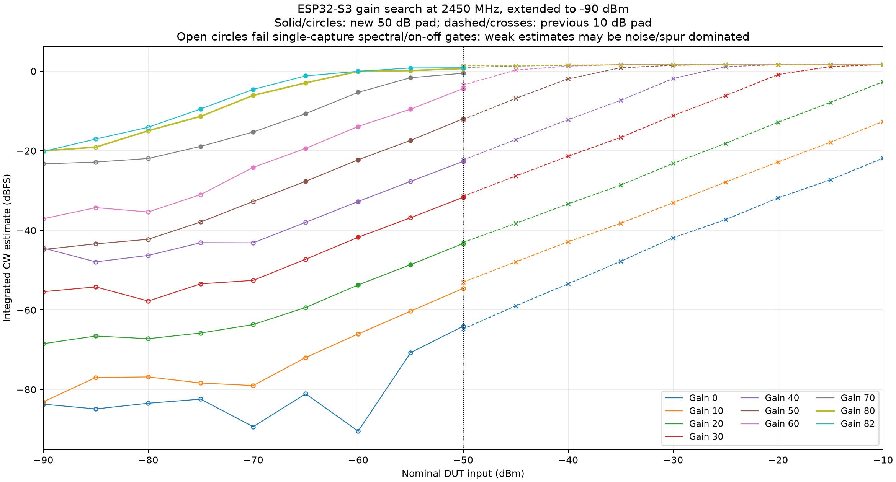
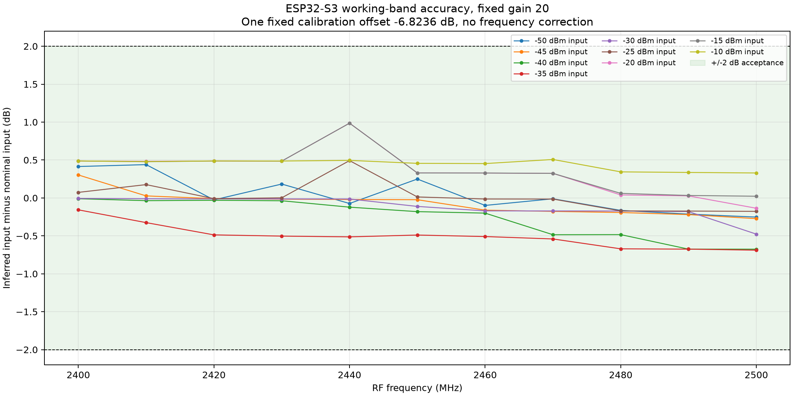
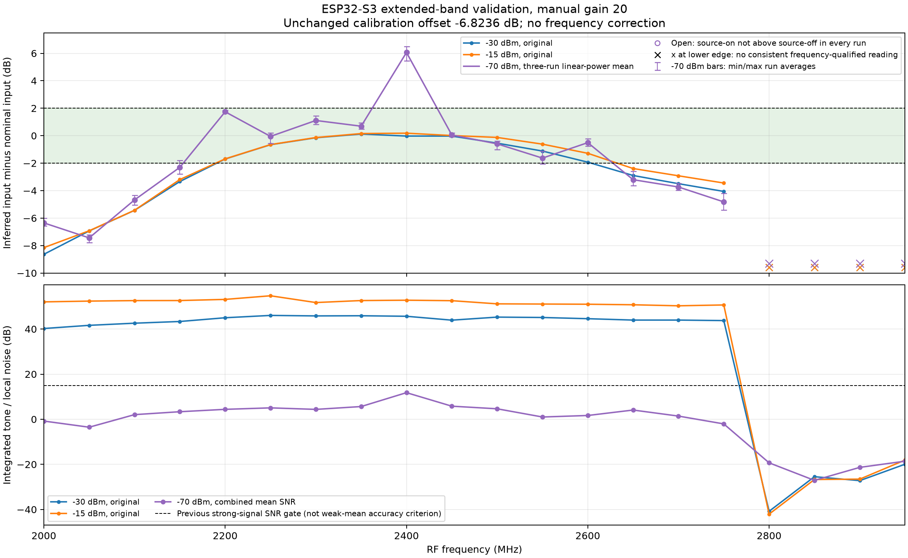
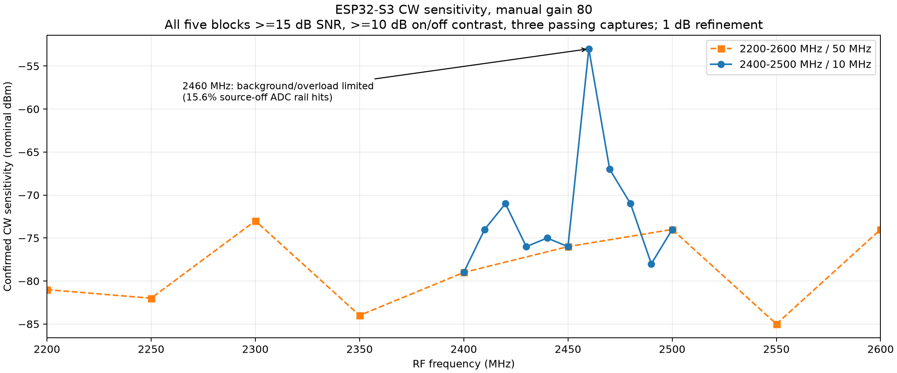

# ESP32-S3 (#1) CW power and sensitivity — phase 1 (10 dB) and phase 2 (50 dB)

## Status

Phase 1 (power accuracy) and Phase 2 (CW sensitivity) are complete for the connected **ESP32-S3**
board. Phase 1 used the **10 dB pad** (nominal DUT input −50…−10 dBm); Phase 2 used the **50 dB pad**
(−90…−50 dBm), including the extended gain search, the adaptive sensitivity scans, raw ADC snapshots
and the 10/50 dB overlap.

All dBm values below are **nominal**: generator output minus the nominal pad. No independent power
meter, calibrated attenuator-vs-frequency data or cable-loss characterisation was available. The
result is integrated CW dBFS, not a traceable absolute power calibration, not a noise figure and not a
Wi-Fi BER/packet-sensitivity result.

## Headline result

With manual gain **20** and one frozen offset of **−6.823643 dB** (anchored at 2450 MHz, −30 dBm):

- working band **2400–2500 MHz / 10 MHz steps** at **−50…−10 dBm in 5 dB steps**: **99/99** points
  passed every gate; worst absolute error **0.9863 dB**, with no per-frequency correction
- most stable levels: **−30 dBm** (worst five-block p-p 0.0302 dB, worst error 0.4769 dB) and
  **−15 dBm** (0.0535 dB, 0.9855 dB)
- extended band **2000–2950 MHz / 50 MHz steps** at those two levels: within ±2 dB over
  **2200–2600 MHz**; tones detectable to 2750 MHz; no reliable tone at 2800–2950 MHz
- **−70 dBm** validation at 2450 MHz: **−69.947 dBm** (+0.053 dB), but only 8/20 grid means within ±2 dB
- phase-2 sensitivity with fixed gain **80**: thresholds **−79…−53 dBm** (2400–2500 MHz / 10 MHz) and
  **−85…−73 dBm** (2200–2600 MHz / 50 MHz); no −90 dBm point passed; 2460 MHz is
  overload/background limited
- 10/50 dB overlap at −50 dBm: **−0.274 / −0.269 / −0.363 / +0.181 dB** for gains 20/30/40/50,
  consistent to within **0.37 dB**









## Board, firmware and capabilities

| Item | Value |
| --- | --- |
| Board | `S3SDR 6 burst 16380`, ESP32-S3 |
| USB serial | `A0:F2:62:F3:9D:AC` |
| Firmware revision | `f86da81807b7f6e850742f6b789d9468c190ad41` |
| Gain | manual indices 0–80 searched, 82 = advertised maximum |
| Profile | 80 MS/s, 2048 bins, 39.0625 kHz spacing, Hann ENBW 58.59375 kHz |
| Reference generator | Rigol RSA3030N `RSA3K253600108`, firmware `00.03.06` |
| Pad | nominal **10 dB** (phase 1), nominal **50 dB** (phase 2) |

No firmware was built or flashed. Hardware AGC was never enabled; the receiver is forced to manual
gain before source-on in every session and the setting is queried back. Reconnecting can restore the
board's default hardware gain, so manual gain is reapplied at each new session. The generator is
switched off after each stage.

## Acquisition and estimator

- On-chip **mean** FFT at the highest advertised profile: **80 MS/s, 2048 bins**, periodic Q15 Hann,
  39.0625 kHz bins (Hann ENBW ≈ 58.59375 kHz); widest analog bandwidth, `DC 1`.
- Zero-span continuous CW with a **100 s** effective sweep time, checked by query. Generator level is
  written, allowed to settle, read back within 0.05 dB, followed by another 0.5 s before capture;
  generator error queue drained per point.
- RF is the generator frequency; the receive LO is always commanded to **RF − 2 MHz**, avoiding the
  DC-corrected bins and keeping the tone at the same relative position in the analog filter.
- Frame power codes decode as `P = 10**(code/20)`; completed-FFT counts weight the means. The tone is
  searched within ±500 kHz, 11 bins around the peak are summed, and a per-frame median local noise
  estimate from the 0.5–1.5 MHz annulus is subtracted.
- Integrated power is normalised by the squared Hann full-scale amplitude (`16383.5**2`) and the Hann
  ENBW (≈1.5 bins), then reported as integrated CW dBFS — not a dBFS-per-bin noise statistic.
- Five consecutive time blocks per capture give the within-capture stability; they are not five
  independent long-term repeats.
- Per-capture gates: every block ≥15 dB tone-to-local-noise ratio; |frequency error| ≤150 kHz;
  five-block peak-to-peak ≤0.5 dB for power points; ≥10 dB on/off against the matching source-off
  capture for detection points; CRC/framing/report accounting, low-seven-bit gain metadata and
  generator readbacks clean. Every frame's sequence, mean-detector mode, FFT shape, drop metadata and
  end report is checked.
- At every reliable tone the frequency error is a constant **+70.31 kHz** (reference/crystal offset),
  inside the 150 kHz gate. No frequency correction is applied.
- The upper gain-metadata bit sometimes toggles even for weak signals; it is preserved but not treated
  as calibrated gain or as proof of clipping. Manual-gain queries and the lower seven bits identify
  the selected index.

## Gain search and G_o selection

Gain indices 0, 10, …, 80 were tested at 2450 MHz over nominal input −50…−10 dBm in 5 dB steps.
Gains 10 and 20 covered the complete span, while higher gains compressed and gain 0 lacked
weak-signal SNR. **Gain 20** was selected for its improved weak-input SNR while retaining at least
2 dB measured full-scale headroom at the largest input. Gains 10 and 20 were then checked at 2400,
2450 and 2500 MHz at −50/−30/−10 dBm before fixing the main-sweep setting.

The single calibration point is gain 20, 2450 MHz, nominal input **−30 dBm**; its integrated reading
was **−23.1763573 dBFS**. The resulting rule is:

```text
Nominal DUT input estimate (dBm) = integrated CW reading (dBFS) - 6.8236427
Generator output estimate (dBm) = nominal DUT input estimate + 10
```

This offset was frozen in `selection.json` **before** the 2400–2500 MHz validation. No fitted slope,
per-frequency correction, per-power correction or gain switching is applied. It is specific to this
device, firmware, analog bandwidth, LO offset and connection. Gain indices are not dB gains, and the
selected gain is the best tested compromise, not a claim that every intermediate index was optimised.

## Working band

All **99/99** independent working-band points passed: RF **2400–2500 MHz in 10 MHz steps**, nominal
DUT input **−50…−10 dBm in 5 dB steps** — the entire 40 dB span available from the supplied
source/pad combination. Worst absolute power error **0.9863 dB**, below the ±2 dB limit, with no
per-frequency correction.

The two most stable levels across the 11 working-band frequencies were:

| Nominal DUT input | Generator setting | Worst five-block peak-to-peak variation | Worst absolute working-band error |
| --- | --- | ---: | ---: |
| −30 dBm | −20 dBm | 0.0302 dB | 0.4769 dB |
| −15 dBm | −5 dBm | 0.0535 dB | 0.9855 dB |

Selection used the smallest worst-frequency block peak-to-peak variation among levels passing all 11
points, with block standard deviation as the tie-breaker. These levels were frozen in `selection.json`
(`phase1_levels`) before the extended sweep. The small stability numbers do not imply that absolute
accuracy or calibration resolution is that fine: on-chip bin codes have 0.5 dB quantization and share
systematic errors.

### Working-band error by input level

| DUT input (dBm) | Maximum absolute error over 2400–2500 MHz (dB) |
| --- | ---: |
| −50 | 0.4394 |
| −45 | 0.3031 |
| −40 | 0.6753 |
| −35 | 0.6886 |
| −30 | 0.4769 |
| −25 | 0.4923 |
| −20 | 0.9863 |
| −15 | 0.9855 |
| −10 | 0.5072 |

## Extended band

Both selected levels were measured at every frequency from **2000 to 2950 MHz in 50 MHz steps**, still
at gain 20 and with the same −6.8236427 dB conversion. Both met the ±2 dB criterion at all tested
frequencies from **2200 through 2600 MHz** (9 frequencies, 18 readings). This only establishes the
wider range for these two powers; the complete −50…−10 dBm grid was validated only in 2400–2500 MHz.

| RF (MHz) | Error at −30 dBm input (dB) | Error at −15 dBm input (dB) | Result |
| --- | ---: | ---: | --- |
| 2000 | −8.64 | −8.15 | Detected, outside accuracy limit |
| 2050 | −6.94 | −6.92 | Detected, outside accuracy limit |
| 2100 | −5.44 | −5.43 | Detected, outside accuracy limit |
| 2150 | −3.34 | −3.19 | Detected, outside accuracy limit |
| 2200 | −1.70 | −1.69 | Pass |
| 2250 | −0.66 | −0.65 | Pass |
| 2300 | −0.15 | −0.13 | Pass |
| 2350 | +0.12 | +0.16 | Pass |
| 2400 | −0.03 | +0.18 | Pass |
| 2450 | −0.03 | +0.01 | Pass |
| 2500 | −0.54 | −0.13 | Pass |
| 2550 | −1.12 | −0.62 | Pass |
| 2600 | −1.93 | −1.28 | Pass, −30 dBm is marginal |
| 2650 | −2.90 | −2.39 | Detected, outside accuracy limit |
| 2700 | −3.49 | −2.92 | Detected, outside accuracy limit |
| 2750 | −4.06 | −3.45 | Detected, outside accuracy limit |
| 2800 | -- | -- | No reliable tone reading |
| 2850 | -- | -- | No reliable tone reading |
| 2900 | -- | -- | No reliable tone reading |
| 2950 | -- | -- | No reliable tone reading |

Tones remained clearly detectable through 2750 MHz, with roughly 40–55 dB integrated SNR at the
reliable points, despite the frequency-dependent power error. At 2800–2950 MHz the detection and
frequency gates failed; diagnostic numbers from noise searches are not valid input-power
measurements. The measurements do not identify a hardware PLL lock state. No frequency correction was
applied to flatten the roll-off. The 2600 MHz / −30 dBm reading passes by only 0.07 dB relative to the
limit, so that edge has little margin for reference uncertainty or drift. Boundaries are based on the
measured grids, not interpolated cutoff frequencies.

A weaker-input validation at **−70 dBm** nominal input (gain 20, 2000–2950 MHz in 50 MHz steps, three
sweeps) gave **−69.947 dBm** at 2450 MHz (+0.053 dB), but only 8/20 frequency-grid means were within
±2 dB; the conversion is therefore weak-input accurate at some frequencies, not uniformly across the
band.

## Phase 2 — 50 dB pad


### Gain search and G_lp

Phase 2 used the supplied nominal 50 dB pad; consistency with the phase-1 data is established by the
−50 dBm overlap described below. The gain search measured 0, 10, …, 80 and the advertised maximum
**82** at 2450 MHz over **−90…−50 dBm** in 5 dB steps, with a matching source-off capture at every
gain.

Indices 70, 80 and 82 shared the weakest coarse passing point of **−75 dBm** under the spectral and
on/off gates. **Gain 80** was selected before the frequency scans because it had the lowest
block-power standard deviation at that edge (**0.299 dB**, versus 0.448 dB at gain 70 and 0.385 dB at
gain 82). The gain is fixed at 80 for all sensitivity-frequency measurements and controls. No
−90 dBm pilot point passed the complete gates, and the later 2460 MHz lower-gain investigation did not
establish a better repeat-confirmed threshold.

Source-off background can contain an apparent peak near the expected CW frequency, at a level that
changes with tuning and gain, so a high local SNR alone can be a false positive. The on/off gate
therefore deliberately makes the results **setup/background limited** where such features are present.
Internal receiver spurs, environmental pickup and residual generator/cable coupling were not
separated.

**Overlap with the 10 dB pad** at −50 dBm: unsaturated gain-20/30/40/50 readings changed by
−0.274 / −0.269 / −0.363 / +0.181 dB, consistent to within 0.37 dB. Saturated and low-SNR overlaps
cannot calibrate attenuation, and no correction was fitted to the overlap.

### CW sensitivity

**No −90 dBm point passed the complete detection criteria.** All requested frequencies have a
confirmed threshold with 1 dB refinement at fixed manual gain 80. These are **setup-limited CW
thresholds**, not intrinsic receiver-sensitivity specifications.

| Requested grid | Best observed threshold | Worst observed threshold | Median |
| --- | ---: | ---: | ---: |
| 2400–2500 MHz, 10 MHz steps | −79 dBm | −53 dBm at 2460 MHz | −74 dBm |
| 2200–2600 MHz, 50 MHz steps | −85 dBm at 2550 MHz | −73 dBm at 2300 MHz | −79 dBm |

The 50 MHz grid does not sample 2460 MHz and therefore misses the severe limitation seen on the finer
grid. Neither connecting plot lines nor the band summary establishes performance between measured
frequencies. Shared points at 2400, 2450 and 2500 MHz give **17 unique RF frequencies**.

| RF (MHz) | 10 MHz grid, confirmed input (dBm) | RF (MHz) | 50 MHz grid, confirmed input (dBm) |
| --- | ---: | --- | ---: |
| 2400 | −79 | 2200 | −81 |
| 2410 | −74 | 2250 | −82 |
| 2420 | −71 | 2300 | −73 |
| 2430 | −76 | 2350 | −84 |
| 2440 | −75 | 2400 | −79 |
| 2450 | −76 | 2450 | −76 |
| 2460 | **−53, overload limited** | 2500 | −74 |
| 2470 | −67 | 2550 | −85 |
| 2480 | −71 | 2600 | −74 |
| 2490 | −78 | | |
| 2500 | −74 | | |

At every tabulated threshold, three separate two-second captures passed all gates, and a tested level
1 dB weaker failed at least one gate. Generator setting is the listed input plus 50 dB. Early passing
single captures that failed repeat confirmation are retained in the data and are not reported as
confirmed sensitivity. The nearest weaker failed level is an empirical bracket, not a confidence
interval or a guarantee between points.

A candidate capture passes only when all of the following hold:

1. all five consecutive time blocks have **≥15 dB** integrated tone-to-local-noise ratio;
2. the FFT peak is within **150 kHz** of the commanded RF frequency;
3. raw integrated power in the same 11 tone bins is **≥10 dB above a matching source-off capture** at
   the same gain, LO and FFT configuration;
4. manual gain queries, low-seven-bit gain metadata, CRC32, frame accounting and generator readbacks
   are valid, with no source errors.

An ascending 5 dB coarse scan is followed by 1 dB refinement and two confirmation captures. Failed
confirmation levels remain in the data; rechecks move to stronger inputs rather than deleting
failures. The 0.5 dB amplitude-variation gate used for the power study is **not** a detection gate
here; five-block variation is retained in the numerical data because the highest gains have
appreciable amplitude variation even when a tone is clearly detectable.

This is **known-frequency CW detectability in the stated FFT configuration**, not Wi-Fi packet/BER
sensitivity, a noise figure, a thermal-noise-limited intrinsic receiver specification, or the ±2 dB
calibrated-power range. The gain-20 power offset is not applied to the high-gain measurements; more
gain helps detect weak tones but does not guarantee stable or accurate amplitude readings.

### 2460 MHz background/overload

At fixed gain 80 the threshold at 2460 MHz was much worse than at adjacent frequencies. Source-off
`CAP20 16380 0` snapshots showed ADC rails being hit even without the wanted source signal:

| Manual gain | Exact ADC rail hits at 2450 MHz | Exact ADC rail hits at 2460 MHz |
| --- | ---: | ---: |
| 40 | 0% | 0% |
| 60 | 0% | 0.647% |
| 70 | 6.581% | 14.886% |
| 80 | 5.845% | 15.589% |

These are fractions of I/Q components equal to −512 or +511, from three raw 16,380-sample snapshots
per setting; signed-IQ packing and CRC32 were checked. They establish high-gain background clipping in
these snapshots, not its cause or its long-term occurrence rate.

Additional source-off controls and 32 source-on tests at 2460 MHz covered manual gains 40, 50, 60 and
70 across −85…−50 dBm. Gains 40–60 did not meet the five-block 15 dB gate; gain 70 had passing single
captures, but no three all-passing captures at any tested level up to the −50 dBm source/pad limit. The
gain-80 −53 dBm value remains the confirmed **observed** threshold; the large source-on background
variation and clipping mean it is not the DUT's intrinsic sensitivity at 2460 MHz. Source
noise/leakage, receiver-generated artefacts and environmental pickup were not independently separated.

## Instrument issues

The Rigol's `TIME:AUTO?` remains 1 in zero span even when a numeric 100-second sweep time is effective.
The library's high-level CW helper rejects that readback, so acquisition uses its low-level SCPI
interface for zero span, explicit sweep time and continuous operation, verifying the actual span and
time. A separate verification varied the frequency across 2000, 2450, 2460 and 2950 MHz and both
selected generator levels, confirming effective 100-second CW operation after every change. Switching
RF off returns the time readback to 0.001 s; that shutdown readback is not the active CW sweep time.
These checks were made after every RF change, and the instrument was verified RF-off at the end of each
session.

The first diagnostic probe stopped because the gain-metadata upper bit changed; metadata handling was
corrected to preserve that bit and verify the actual low-seven-bit index. The initial gain-search
session stopped after 61 valid captures when a generator level readback did not match its request; no
reading was accepted at that mismatched setting. The generator was separately checked and switched
off. Readback-and-settle retries and error-queue logging were added, and gains 60/70/80 were measured
in a separate session. Early diagnostic sessions include a Rigol `-32754,"do err"` queue entry and are
not treated as error-free metrology; later point-level error lists make any source-side warnings
explicit.

## Integrity and replay

All **249** phase-1 captures were replayed from their raw codes and headers, reproducing tone power,
SNR, frequency, block standard deviation and peak-to-peak metrics within 1e-10 of the saved values.
Every capture had successful end status, zero frame drops, complete frame/FFT accounting and matching
low-seven-bit gain metadata; live acquisition checked frame CRC32 before accepting data. The main
working-band session contains **47,110 frames / 573,275 FFTs** and the extended session
**19,013 frames / 231,653 FFTs**, both with empty per-point and end-of-session generator error queues.
A synthetic Hann-window tone verifies integration and normalization within **0.01 dB**.

All **358** phase-2 captures were replayed, covering **155,966 frames / 1,896,693 completed FFTs**,
with no output frame drops or per-point/end source errors. Every active CW point read back a
100-second sweep time. All **24** raw ADC snapshots passed CRC, signed-IQ decode and rail-statistic
reconstruction checks, and all 17 final thresholds meet the recorded SNR/on-off gates in three
captures with a weaker failure exactly 1 dB below.

The fixed-gain calibration, the stable-level choice, the gain choice and the gates all predate the
corresponding validation sessions. RF output was verified off at completion and manual gain was
reasserted and queried before releasing the serial lease. The main sweep ran on 2026-10-21,
12:40:18–12:45:28 UTC; extended acquisition finished at 12:48:22 UTC. Exact session timestamps are in
the JSON records.

## Data files

| File | Content |
|---|---|
| `measurements.csv` | per-capture metrics, both pads, source-on and source-off |
| `sensitivity.csv` | confirmed CW threshold per RF with the weaker failed level |
| `gain_search.csv` | extended gain curve, −90…−10 dBm, both pads |
| `gain_overlap.csv` | 10 dB vs 50 dB reading comparison at −50 dBm |
| `adc_background.csv` | source-off raw ADC statistics: rail hits, AC RMS |
| `selection.json` | `phase1`, `phase1_levels` and `phase2` decisions |
| `summary.json` | `phase1` and `phase2` band statistics and validated ranges |
| `plots/` | figures referenced above |

Acquisition and analysis scripts are in the repository's `tools/` directory.

## Limits of the conclusion

The ±2 dB criterion is an empirical comparison to generator setting minus the nominal pad. Generator
level accuracy, source impedance, attenuator loss versus frequency, connectors and DUT mismatch are
inside the observed system response and have not been separated. No frequency interpolation,
continuous-band guarantee, modulated-signal power calibration, antenna-power calibration, calibrated
sensitivity/noise figure, temperature stability or long-term repeatability is implied.

Sensitivity values are nominal and setup-limited: source-off tests constrain false positives but do not
establish absolute delivered power or isolate every leakage path. The refined power grid has 1 dB
resolution; repeat variation, 0.5 dB FFT-bin encoding and reference uncertainty remain additional
limitations. The narrowband CW estimator requires the tone frequency to be known approximately and the
LO retuned with it; outside the tested range a response or noise peak is not a valid power reading even
if a number can be computed. The results concern this board, firmware, RF/LO offset, bandwidth, gain,
integration window and sampled capture conditions, and do not establish interpolated band edges,
performance below −90 dBm, or general antenna/modulated-signal sensitivity.
