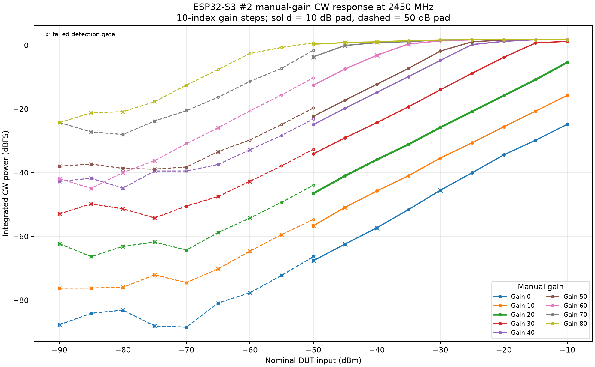
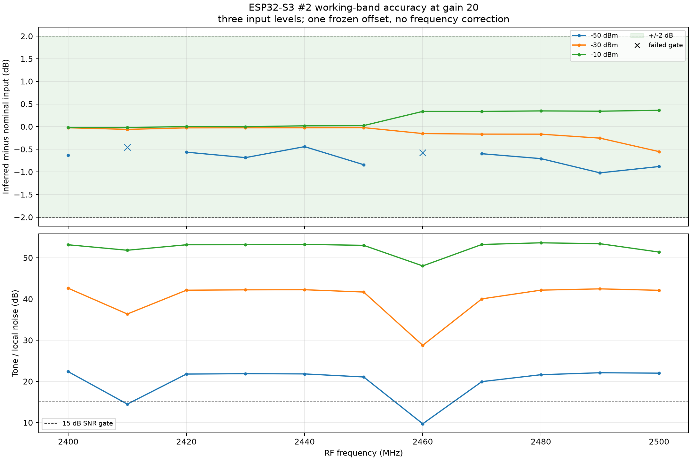
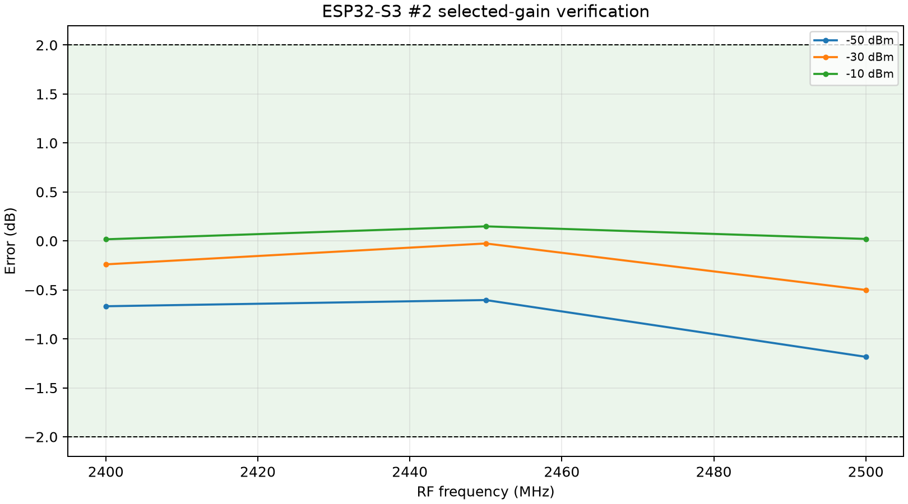
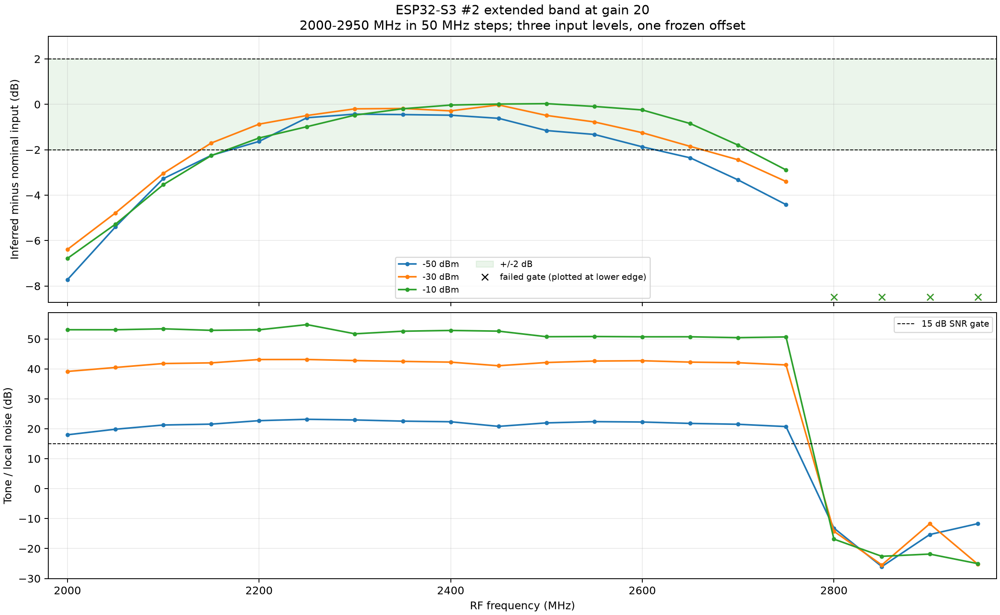
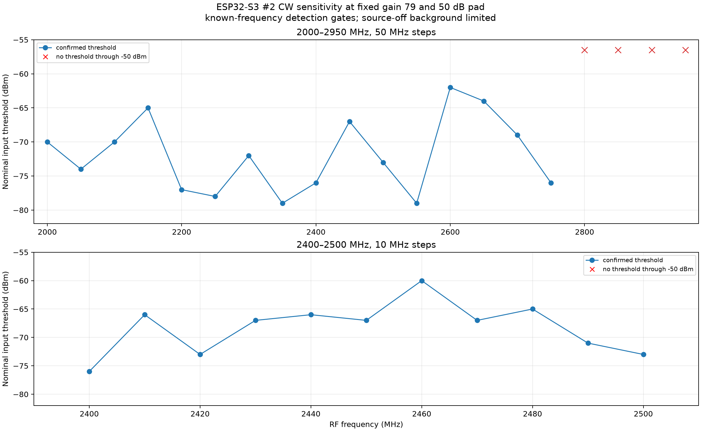
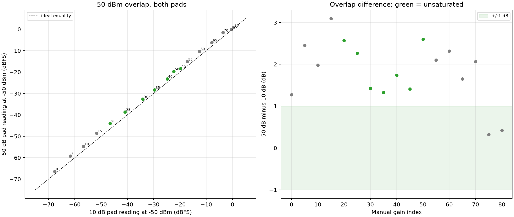
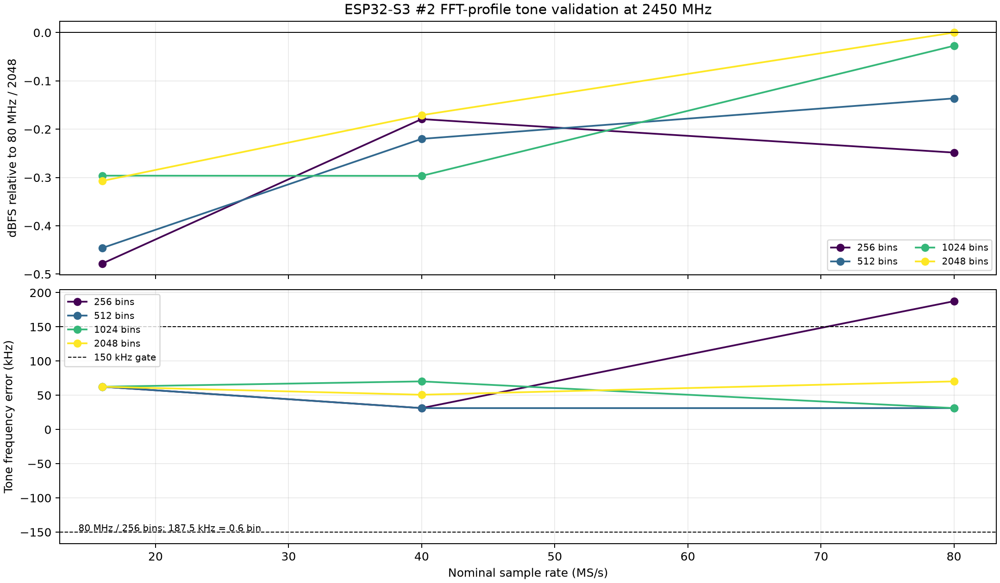

# ESP32-S3 #2 CW power and sensitivity — phase 1 (10 dB) and phase 2 (50 dB)

## Status

Phase 1 and Phase 2 are complete for the connected **ESP32-S3** board. Phase 2
used the **50 dB pad**: 5-index gain search, gain-79 sensitivity, 10/50 dB
overlap, raw ADC snapshots and FFT-profile validation.

All dBm values below are **nominal**: generator output minus the nominal pad.
No independent power meter or calibrated attenuator-vs-frequency data was
available. The result is integrated CW dBFS, not a traceable absolute power
calibration, not a noise figure and not a Wi-Fi BER/packet-sensitivity result.

## Headline result

With manual gain **20** and one frozen offset of **-4.175441 dB**:

- working band **2400–2500 MHz / 10 MHz steps** at **-50, -30 and -10 dBm**:
  **31/33** captures passed every gate; all valid points were within +/-2 dB
- worst valid working-band error: **1.022 dB**
- selected-gain verification at 2400/2450/2500 MHz: **9/9 passed**, worst
  **1.183 dB**
- phase-2 selected gain **G_lp = 79**; best sensitivity threshold **-79 dBm**,
  worst **-60 dBm** on the requested grids; no -90 dBm threshold was achieved.
- the 10/50 dB overlap at -50 dBm differs by **+1.905 dB mean** and
  **2.598 dB worst**, indicating a nominal-pad/setup uncertainty of 1–3 dB.
- extended band **2000–2950 MHz / 50 MHz steps** at the same three levels:
  - **-50 dBm:** within +/-2 dB over **2200–2600 MHz**
  - **-30 dBm:** within +/-2 dB over **2150–2650 MHz**
  - **-10 dBm:** within +/-2 dB over **2200–2700 MHz**
  - joint all-three-level range: **2200–2600 MHz**
  - no reliable tone at **2800–2950 MHz**

Two working-band captures failed the detection gates and are retained:
**2410 MHz / -50 dBm** (SNR 14.49 dB, on/off 9.56 dB) and **2460 MHz /
-50 dBm** (SNR 9.72 dB, on/off 8.38 dB). The -30 and -10 dBm working-band
grids passed completely.

## Board, firmware and capabilities

| Item | Value |
| --- | --- |
| Board | `S3SDR 6 burst 16380`, ESP32-S3 |
| USB serial | `A0:F2:62:F3:A1:8C` |
| Firmware revision | `9b61e7465bee6da15209c5c09308043d08c46a1d` |
| Build | 2026-10-26T21:26:29Z, profile `esp32s3` |
| Transport | USB, protocol 6 |
| `LIMITS?` | gain `[0,82,1]`; bandwidth `[13,69,1,0]` MHz; rates 80/40/16 MS/s; 8/10-bit I/Q |
| `SPECINFO?` | continuous S3 spectra; highest profile **80 MS/s, 2048 bins** |
| Reference generator | Rigol RSA3030N `RSA3K253600108`, firmware `00.03.06` |
| Pad | nominal **10 dB** attenuator (phase 1), changed to nominal **50 dB** (phase 2) |

This is a second ESP32-S3 board, serial `A0:F2:62:F3:A1:8C`.

The pad check used gain 20 / 2450 MHz / nominal -30 dBm: integrated output
**-25.90 dBFS**, SNR 41.1 dB, block p-p 0.063 dB. That is consistent with the
10 dB pad, not a 50 dB pad.

## Acquisition and estimator

- Highest advertised profile: **80 MS/s, 2048 bins**, 39.0625 kHz spacing,
  Hann ENBW 58.59375 kHz. S3 continuous spectra.
- Generator: zero-span, continuous CW, checked **100 s** sweep time; level
  readback within 0.05 dB and a further 0.5 s settle before capture. Generator
  error queue drained at each point.
- LO commanded to **RF - 2 MHz** for every point.
- Estimator: search +/-500 kHz, sum 11 bins around the peak, subtract the
  per-frame median noise from the 0.5–1.5 MHz annulus, weight by completed FFT
  count, normalize by Hann/ENBW, report integrated dBFS.
- Per-capture gates: every block SNR >= 15 dB; |frequency error| <= 150 kHz;
  on/off >= 10 dB against the matching source-off capture; block peak-to-peak
  <= 0.5 dB; CRC/framing/report accounting and gain metadata clean; no
  generator errors.
- The measured frequency error was a constant **+70.31 kHz** at all tested
  frequencies, within the 150 kHz gate. No frequency correction was applied to
  this S3 data.

## Gain search and G_o

Gains were measured in **5-index steps** from the start:
**0, 5, 10, …, 80**. The search used all nine input levels from -50 to -10 dBm
in 5 dB steps at 2450 MHz.

| Gain | Longest passing range | Headroom at upper end | Result |
| ---: | --- | ---: | --- |
| 15 | -45 to -10 dBm | 10.82 dB | partial range |
| **20** | **-50 to -10 dBm** | **5.40 dB** | **selected, full range, min SNR 20.76 dB** |
| 25 | -50 to -10 dBm | 0.37 dB | full range but fails 2 dB headroom |
| 30 | -50 to -15 dBm | negative | compressed at high input |
| 35–80 | progressively narrower | negative | compressed |

Gain 20 was the only gain satisfying the full -50..-10 dBm range with all
gates and at least 2 dB measured headroom. The selection was frozen in
[`selection.json`](selection.json) before the final working/extended band
acquisitions.

## Working band (3 input levels)

Only **-50, -30 and -10 dBm** were used for the band error measurements, as
requested.

| Input | Captures | Gate failures | Max abs error among valid points |
| ---: | ---: | --- | ---: |
| -50 dBm | 11 | 2410, 2460 MHz | 1.022 dB |
| -30 dBm | 11 | none | 0.552 dB |
| -10 dBm | 11 | none | 0.360 dB |

The two failed -50 dBm points are retained in
[`measurements.csv`](measurements.csv) and marked in the plot. The failure is
SNR/on-off limited, not a missing tone. All 31 valid points are within +/-2 dB.

## Extended band (3 input levels)

The 2000–2950 MHz grid used 50 MHz steps and the same three input levels.

| Input | Within +/-2 dB | Notes |
| ---: | --- | --- |
| -50 dBm | **2200–2600 MHz** | roll-off below 2200 and above 2600 |
| -30 dBm | **2150–2650 MHz** | roll-off below 2150 and above 2650 |
| -10 dBm | **2200–2700 MHz** | roll-off below 2200 and above 2700 |
| joint all three | **2200–2600 MHz** | nine 50 MHz points |

No reliable tone was detected at **2800, 2850, 2900 or 2950 MHz**. The worst
valid extended-band error, including points outside the +/-2 dB range, was
**7.72 dB at 2000 MHz / -50 dBm**. The extended grid is a 50 MHz-step
measurement, not a continuous-band guarantee.

## Phase 2 — 50 dB pad

### Pad verification and G_lp selection

The 50 dB pad was verified at gain 20 / 2450 MHz: generator -20 dBm (nominal
-70 dBm input) read **-64.67 dBFS**, consistent with 50 dB rather than 10 dB.

The gain search used **5-index steps** (0, 5, …, 80) at 2450 MHz over
**-90…-50 dBm**. Fine tuning was restricted to the five-value range **78–82**
after the coarse scan. Selection used the weakest passing input, with block
standard deviation as the tie-breaker.

**Selected gain: 79.** At -70 dBm:

| Metric | Value |
| --- | ---: |
| Nominal input | -70 dBm |
| Block SNR | 16.97 dB |
| On/off excess | 17.26 dB |
| Five-block standard deviation | 0.1671 dB |
| Five-block peak-to-peak | 0.3798 dB |

No gain reached -75 dBm. Gains 78, 80, 81 and 82 also passed at -70 dBm; their
block standard deviations were 1.151, 0.189, 0.302 and 0.599 dB. The choice was
frozen in `selection.json` (`phase2`) before the sensitivity scans.

### Sensitivity at G_lp = 79

The adaptive scan used the same 5 dB coarse / 1 dB refine / two-confirmation
procedure and required three passing captures at the confirmed level. Source-off
background is severe at gain 79, so the on/off gate dominates and **no -90 dBm
threshold was found**. The best confirmed threshold was **-79 dBm**.

**2200–2600 MHz, 50 MHz steps — 9/9 confirmed**

| RF (MHz) | Threshold (dBm) | RF (MHz) | Threshold (dBm) |
| ---: | ---: | ---: | ---: |
| 2200 | -77 | 2400 | -76 |
| 2250 | -78 | 2450 | -67 |
| 2300 | -72 | 2500 | -73 |
| 2350 | -79 | 2550 | -79 |
|  |  | 2600 | -62 |

**2400–2500 MHz, 10 MHz steps — 11/11 confirmed**

| RF (MHz) | Threshold (dBm) | RF (MHz) | Threshold (dBm) |
| ---: | ---: | ---: | ---: |
| 2400 | -76 | 2460 | -60 |
| 2410 | -66 | 2470 | -67 |
| 2420 | -73 | 2480 | -65 |
| 2430 | -67 | 2490 | -71 |
| 2440 | -66 | 2500 | -73 |
| 2450 | -67 |  |  |

**2000–2950 MHz extension, 50 MHz steps.** 16 of 20 frequencies had a confirmed
threshold; no threshold was found at **2800, 2850, 2900 or 2950 MHz**. The
confirmed thresholds were: 2000 -70, 2050 -74, 2100 -70, 2150 -65, 2200 -77,
2250 -78, 2300 -72, 2350 -79, 2400 -76, 2450 -67, 2500 -73, 2550 -79,
2600 -62, 2650 -64, 2700 -69, 2750 -76 dBm.

The median on the requested 2200–2600 MHz grid is **-76 dBm**; on the
2400–2500 MHz grid it is **-67 dBm**. These are **setup-limited** results, not
intrinsic receiver sensitivity. The worst points are **2460 MHz (-60 dBm)**,
**2600 MHz (-62 dBm)** and **2150/2480 MHz (-65 dBm)**.

### Outliers, source-off background and raw ADC

Raw `CAP20 16380 0` snapshots at gain 79 (three source-off and three source-on
repetitions per frequency) are summarised in [`raw_adc.csv`](raw_adc.csv).

- **2410 and 2460 MHz:** source-off RMS was about -11 dBFS, with **exact ADC
  rail hits on 0.55–0.66% of I/Q components**. These are genuine high-gain
  background/clipping conditions, not a missing source tone.
- **2600 MHz:** high source-off background and a -62 dBm threshold.
- **2800 MHz:** source-on raw RMS reached **-2.7 dBFS** even though the
  on-chip spectrum found no reliable tone at the expected frequency. This is
  retained as an outlier rather than reported as a sensitivity point.
- **2000–2150 MHz:** source-off RMS is also high (-25 to -17 dBFS) and limits
  the on/off gate.

### Usable range at G_o (10 dB pad, phase 1)

Step 6 of the phase-2 plan was adapted to the requested three-level phase-1
scan (-50, -30, -10 dBm); **-15 dBm was not measured**. From the phase-1 data:

| Level | 2000–2950 MHz, 50 MHz | 2400–2500 MHz, 10 MHz |
| ---: | --- | --- |
| -50 dBm | **2200–2600 MHz** | 2400–2600 except gate failures at 2410/2460 |
| -30 dBm | **2150–2650 MHz** | all 11 frequencies |
| -10 dBm | **2200–2700 MHz** | all 11 frequencies |
| joint all three | **2200–2600 MHz** | — |

The corresponding phase-1 plots are
[`plots/working_band.png`](plots/working_band.png) and
[`plots/extended_band_50mhz.png`](plots/extended_band_50mhz.png).

### 10 dB / 50 dB overlap at -50 dBm

At the same nominal -50 dBm input, the 50 dB-pad readings are systematically
higher than the 10 dB-pad readings:

| Result | Value |
| --- | ---: |
| Valid unsaturated gains | 20, 25, 30, 35, 40, 45, 50 |
| Mean 50-minus-10 dB difference | **+1.905 dB** |
| Worst absolute difference | **2.598 dB** (gain 50) |

No correction was fitted. The offset is larger than the C5 overlap and
indicates a nominal-pad/setup difference of roughly 1–3 dB; it is part of the
uncertainty of the nominal dBm labels.

### FFT coverage

All **12 advertised S3 profiles** were measured at 2450 MHz with nominal
-50 dBm input at gain 60. The first 80 MHz / 2048-bin attempt read -3.34 dBFS
while every other profile and a repeat read about -15.5 dBFS; the first capture
was discarded as an outlier and the repeat is used.

| Check | Result |
| --- | --- |
| Profiles | 12: 80/40/16 MS/s × 256/512/1024/2048 bins |
| Integrated power spread vs 80 MHz / 2048 | **0.478 dB** maximum |
| Maximum frequency error | **187.5 kHz** (80 MHz / 256 bins = 0.6 bin) |
| Minimum mirror/image rejection | **12.8 dB** (16 MHz / 256 bins) |
| Peak position | all within the expected bin / 150 kHz-or-one-bin criterion |
| Frames / FFTs | **5,740 / 189,366** |

The low mirror rejection at 16 MHz / 256 bins is reported explicitly; it is an
IQ-image/alias-margin limitation, not a misidentified tone.

### Phase-2 integrity

- **509** phase-2 captures/controls/FFT profiles were replayed from raw codes
  and headers with **0.0** metric difference.
- **48** raw ADC snapshots were re-decoded; payload CRCs and I/Q arrays
  matched.
- Reports, frame/FFT accounting, code shapes, gain metadata and zero drops all
  matched.
- The phase-2 selection precedes the sensitivity scan.
- Final state passed: RF off, generator errors empty, manual gain 79
  reasserted and verified, lease released.
- Phase-2 spectrum totals: **213,416 frames / 2,694,890 FFTs**.

### Phase-2 limits

- Nominal 50 dB pad only; the overlap shows a 1–3 dB discrepancy against the
  10 dB phase-1 data, so absolute nominal input has at least that much setup
  uncertainty.
- Sensitivity is known-frequency CW detectability with this estimator and
  source-off gate. It is not Wi-Fi BER, noise figure or a thermal-noise limit.
- No -90 dBm threshold was achieved at gain 79. The best observed was -79 dBm.
- Source-off background and ADC rail hits at high gain are part of the setup
  limitation and were not separated into internal versus external causes.
- The 50 MHz extended sensitivity grid does not interpolate between measured
  frequencies.

## Integrity and replay

- **300** saved on-chip FFT captures/controls were replayed from raw codes and
  headers; tone power, SNR, frequency, block statistics and on/off excess
  reproduced with **0.0** difference.
- All end reports, frame/FFT counts, code shapes, low-seven-bit gain metadata
  and frame accounting matched.
- Measurement sessions: 103,965 frames / 1,254,431 completed FFTs. Controls:
  21,559 frames / 260,364 FFTs.
- The frozen selection timestamp precedes the final working/extended band
  acquisitions.
- Phase-1 final state passed: RF output off, generator error queue empty,
  manual gain 20 reasserted and verified, lease released. After phase 2,
  the `final_state` record in `validation.json` is the phase-2 gain-79 entry; the
  phase-1 entry embeds the earlier gain-20 state.
- Live acquisition checked CRC32/framing before accepting frames.

## Data files

| File | Content |
|---|---|
| `measurements.csv` | per-capture metrics, both pads, source-on and source-off |
| `sensitivity.csv` | confirmed CW threshold per RF with the weaker failed level |
| `pad_overlap.csv` | 10 dB vs 50 dB reading comparison at -50 dBm |
| `fft_profiles.csv` | per-profile tone accuracy, image rejection, frame and FFT counts |
| `raw_adc.csv` | source-off raw ADC statistics: rail hits, AC RMS and peak count |
| `selection.json` | frozen gain, offset and gate decisions plus the LO calibration model |
| `summary.json` | band statistics, integrity and limits |
| `validation.json` | replay outcomes, checks and final instrument state |
| `plots/` | figures referenced above |

Acquisition and analysis scripts are in the repository's `tools/` directory.

## Limits

- Nominal input only: generator setting minus the nominal pad. Pad loss versus
  frequency, connectors, mismatch and generator accuracy were not separated.
  The 10/50 dB overlap differs by roughly 1–3 dB, so nominal input has at least
  that setup uncertainty.
- Gain 20 and the offset -4.175441 dB are specific to this board, firmware,
  analog bandwidth, LO offset and estimator. Gain indices are not dB.
- No frequency correction was applied; the measured +70.31 kHz error was
  inside the gate.
- The working band at -50 dBm has two gate failures; no interpolation should
  be used to call those frequencies valid.
- The extended band is a 50 MHz grid. The +/-2 dB intervals are measured
  ranges, not interpolated band edges.
- This is not noise figure, not Wi-Fi BER/packet sensitivity and not an
  absolute traceable power calibration.
- Phase-2 sensitivity is setup-limited at gain 79; no -90 dBm threshold was
  achieved. The best confirmed threshold was -79 dBm.
- High-gain source-off background and ADC rail hits at 2410/2460 MHz are part
  of the measured limitation, not separated into internal versus external causes.
